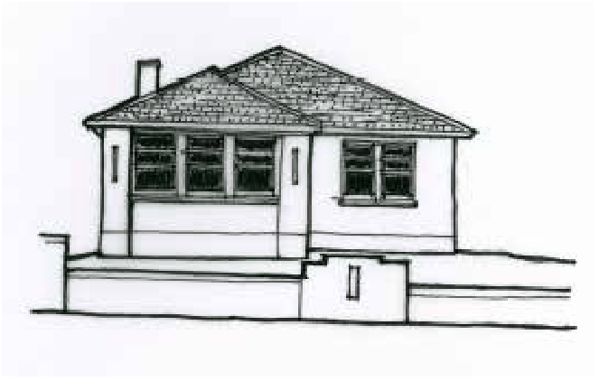
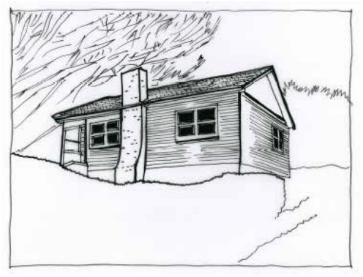
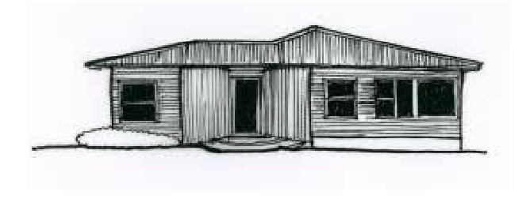
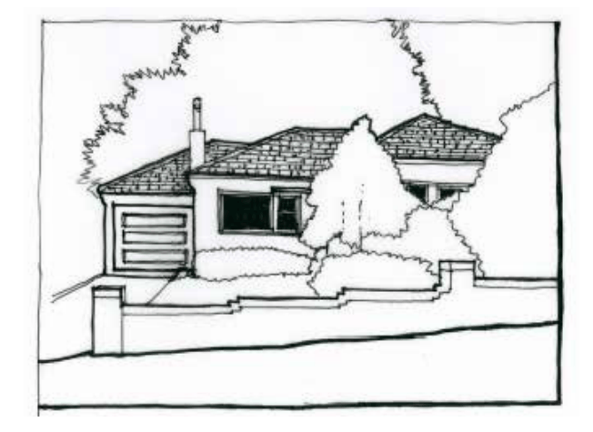

### D12.3	 Post-War cottages (c.1945-c.1960)

Many parts of the Blue Mountains older town areas contain a variety of Post- War dwellings which display significant character. These dwellings add another historical layer to older areas and often make a significant contribution to streetscape values.

Part D: Heritage

Houses built in the Post-War years are generally simple in form and materials. They include the Austerity style houses of the 1950s and the range of project houses built in the 1960s and 1970s.  General characteristics continue to demonstrate the heritage values of the villages and towns, including the low density patterns of development, the importance of gardens and a natural setting and the generally modest scale of structures. Many traditional or accepted features were retained from earlier models:

•	 Maintenance of single-storey forms •	 Simple low brick fences with details to

match house

•	 Use of brick and tile as the main building materials

•	 Weatherboards, with smaller and plainer profiles

Several key differences can be seen between the houses of the pre and post

WW2 periods:

•	 Entry areas were small porches

•	 Simplification of the details of earlier periods

•	 Chimneys could be a decorative feature, with decorative brickwork and placement on exterior walls facing the street

•	 Materials include timber weatherboard cladding, brick and asbestos cement (fibro) panels

•	 Single-storey forms sometimes had a garage underneath

•	 Picture windows became a feature of front and side elevations, often set at a principal front corner

•	 Lower-pitched roofs, with sometimes complex hipped roof form variations

•	 Complexity of asymmetrical forms pre-sented to the street

•	 Windows timber or aluminium-framed

•	 Glazed terracotta roof tiles in favour of unglazed

•	 Front fences were often low walls built using matching brick, and could have welded panels in contemporary designs

•	 Specimen tree plantings were popular in the early post-War years, with native plantings becoming popular towards the end of the century

•	 The growing importance of the garage

> [Picture on page 86: a picture, saved as a picture (images/part-d-heritage-management-page-86-21.gif, 150 dpi).]

Part D: Heritage

Part D - Figure 32: Simple Post-War cottage including low brick fence with details to match house. Note larger size of windows in relation to wall area.

> [Picture on page 87: a picture, saved as a picture (images/part-d-heritage-management-page-87-1.gif, 150 dpi).]

Part D - Figure 33: Post-War cottage c.1950s with external chimney as feature to front elevation.

> [Picture on page 87: a picture, saved as a picture (images/part-d-heritage-management-page-87-4.gif, 150 dpi).]

Part D: Heritage

Part D - Figure 34: Post-War timber weatherboard cottage of unusual design and form, with curved panels of vertical weatherboards framing entry. Post-War weatherboards are relatively narrow.

> [Picture on page 87: a picture, saved as a picture (images/part-d-heritage-management-page-87-9.gif, 150 dpi).]

Part D - Figure 35: Post-War cottage with garage incorporated into building form resulting in a more complex roof form.

Part D: Heritage
