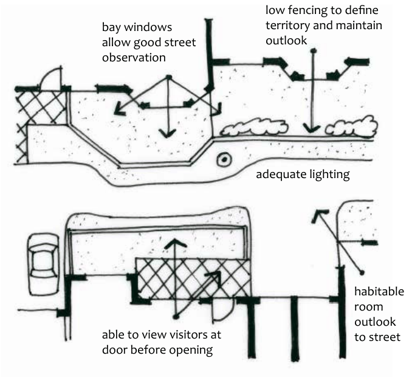

### E5.1.1.	 General provisions for all development

C1. Design is to minimise the opportunity for crime by:

(a) ensuring that passive surveillance of buildings, streets, car parking facilities and open spaces is maximised, and

(b) utilising elements such as signage, building features or landscaping to reduce the likelihood of inappropriate activity and clearly define individual areas and uses, and

(c) incorporating landscaping, without providing places for concealment.

C2. Development is to provide or enhance opportunities for effective passive surveillance by providing:

(a) clear sight lines between public and private places, and

(b) designs which maximise natural observation of vehicle and pedestrian movement.

C3. Access to development is to be controlled by:

Part E5: Safety and Security

(a) avoiding upper level access due to large trees, carports, skillion extensions, fences or downpipes next to upper level windows or balconies; and

(b) restricting access from the balconies, roofs and windows of neighbouring development.

C4. Development is to reinforce site boundaries and distinct areas by providing transitional features to strengthen the distinction between private space and the public domain. Strategies could include fences, gardens, lawn strips, and varying textured surfaces to create physical or psychological barriers.

> [Picture on page 72: a map, saved as a picture (images/part-e-site-development-and-management-page-72-1.gif, 150 dpi); the street names and other small labels are on the picture.]
> Labels printed on the map (copied from the PDF, in no particular order):
> low fencing to define · territory and maintain · outlook · bay windows · allow good street · observation · adequate lighting · habitable · room · outlook · to street · able to view visitors at · door before opening

Part E5: Figure 1: Security by design. Source: Amcord

Part E5: Safety and Security

E5.1.2.	 Additional provisions for Multi-dwelling housing,

### Commercial, Industrial and Mixed-use developments

C1. Development for the purposes of medium-density housing and certain commercial, industrial and/or mixed-use development proposals may be required to provide a crime minimisation statement  which demonstrates how the development has been designed with consideration to the principles of crime prevention through environmental design (CPTED) and the provisions of this section.

Note: This requirement is in accordance with Council’s Blue Mountains Crime Prevention Plan 2014-2017.

C2. Development is to provide opportunities for passive surveillance by:

(a) positioning active uses or habitable rooms with windows adjacent to main communal/public areas, such as playgrounds, swimming pools, gardens, car parks, etc., and

Note: Passive surveillance from interior spaces needs to be balanced with potential acoustic impacts on habitable areas.

(b) creating staff entrances that are separate from the main entrance and located to maximise opportunities for natural surveillance from the street or other public areas, and

(c) locating offices, desks, and work-stations so as to overlook public areas, car parking areas and entrances to buildings, and

(d) activating façades at ground level by locating after-hours uses so they are visible from the publicly accessible areas.

C3. Development access is to be controlled by:

(a) providing separate access from public and common areas, and

(b) providing separate access for any residential components of mixed-use developments, and

(c) providing secure keyed or electronic access for residents where appropriate, and

(d) fitting the main entry doors with viewing ports to allow identification of visitors, and

(e) designing the route between the main entrance of a development and the dwellings within it to maximise occupant safety and be as direct as possible. The routes from car parking areas to the lift lobby are particularly important in this regard. Clear sight lines and well-lit routes are to be provided.

Part E5: Safety and Security

C4. Concealment opportunities are to be minimised from development by:

(a) eliminating blind or dark alcoves near lifts and stairwells, and

(b) providing clear sight lines and well lit routes throughout the development, and

(c) providing appropriate levels of illumination for all common areas.

C5. Development is to encourage a sense of community ownership of public spaces by:

(a) encouraging people to gather in common spaces and engender a sense of responsibility for its use and condition, and

(b) clearly defining the use of common spaces, and

(c) distinguishing dwellings or groups of dwellings or uses by using design features such as colour, vegetation, paving, fencing, furniture etc.

C6. Where, as a result of the nature of the development, there are specific security requirements, measures to meet such requirements are to be included at the design stage and identified on submitted plans.

C7. Roller shutters are discouraged in preference to retractable open security grilles, such as scissor grilles.

C8. Larger scale developments and developments for certain land uses may be referred to the NSW Police Service for formal comment and are likely to require a crime minimisation statement. These developments include:

(a) multi-dwelling housing of 20 or more dwellings; and

(b) mixed use developments (incorporating retail/commercial and residential uses) containing more than 5 dwellings; and

(c) new or upgraded commercial/retail developments which include substantial building works and entry/access changes; and

(d) new industrial development with multiple industrial units; and

(e) new or upgraded schools, child care centres, hospitals; and

(f) any development on or associated with railway stations; and

(g) large sporting or community facilities; and

(h) clubs and hotels (including additions, applications for liquor licences, extension to operating hours, gaming rooms etc.); and

Part E5: Safety and Security

(i) service stations (including the addition of retail element); and

(j) atypical developments (including sex services premises, amusement centres etc.); and

(k) community parks (whether large or small); and

(l) civic buildings/development (such as libraries, public open space).

Note: Requirements will vary depending on the size and scope of the application. This requirement is in accordance with Council’s Blue Mountains Crime Prevention Plan 2014-2017.
