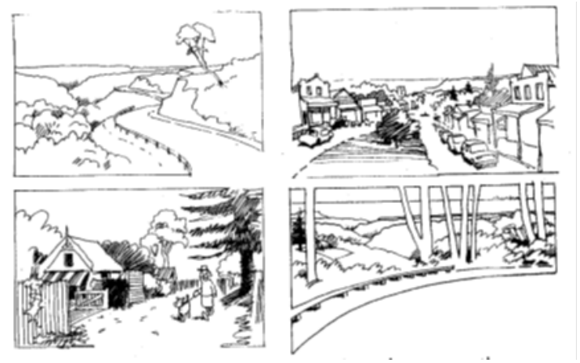

### E8.1. Street  Hierarchy

#### Introduction

The natural topography of the Blue Mountains means that the towns and villages connected by roads and separated by bushland have a particularly distinct character. Roads dip and bend across the topography, and streets open up to famous vistas or are enclosed by canopies of trees and the thickness of native vegetation. Back lanes and scenic drives, suburban roads, formal avenues and the Great Western Highway are all distinctive responses to topography, development, traffic and engineering. This hierarchy of streets adds to the legibility of the Local Government Area as a whole and the individual towns and villages to locals and visitors alike. The scale of the road to the setting, the character and quality of edge treatments, the design of infrastructure and the layout and materials of footpaths all signal the logic of the local development pattern for residents and visitors.

> [Picture on page 112: a picture, saved as a picture (images/part-e-site-development-and-management-page-112-15.gif, 150 dpi).]

Part E8: Public Domain

Part E8 - Figure 1: Distinctive scenic views give the Blue Mountains a unique character of natural and cultural beauty The design of street elements may enhance or devalue the experience for observers - whether town centre, residential back street, or major regional

road. The following objectives and controls seek to maintain and enhance this distinctive pattern and hierarchy. This section applies when work is proposed within the public or private domain on or adjacent to the following road types, regardless of the scale or type of development.
