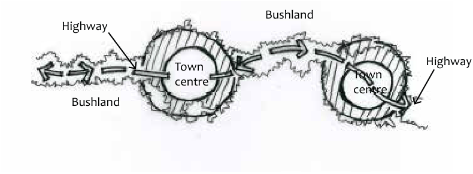

### E8.1.1.	 Great Western Highway

#### Explanation

The Great Western Highway has been the major route through the Blue Mountains since the early nineteenth century. It has developed multiple layers of character and heritage deserving of considerable respect. Its linear configuration connects a string of towns and villages and increases rapidly in elevation from around 60m above sea level to over 1000. There is a clear progression of separated and distinct towns and villages which are, individually and together, integral to the character and identity of the local government area.

> [Picture on page 113: a picture, saved as a picture (images/part-e-site-development-and-management-page-113-10.gif, 150 dpi).]
> Words printed on the picture (copied from the PDF):
> Bushland
> Highway
> Town
> centre
> Town
> centre
> Bushland

Highway

Part E8 - Figure 2: The linear configuration of the Great Western Highway has created a string of separated and distinct towns and villages

Part E8: Public Domain

All roadwork and maintenance between the roadside kerbs along the Highway is the responsibility of the Roads and Maritime Service and it is recommended that contact is to be made with this agency in advance of lodging any application requiring works in this area. The following controls focus on areas between the back of the kerb and the private property boundary.

#### Objectives

O1. To maintain the separation of towns and strengthen the bushland character of the land between towns.

O2. To ensure the Great Western Highway retains its historic associations, physical remnants and landscape elements that contribute to its streetscape;

O3. To considerately integrate new development into the historic environment.

O4. To consider the potential impacts upon the scenic and character values of the location.

O5. To continue to landmark the town and village centres with appropriate street tree planting, or the town entry access from the Great Western Highway, as appropriate.

O6. To ensure safe and appropriate landscaping that simultaneously consolidates desired location character, improves pedestrian amenity and maintains open sight lines and safety.

O7. To continue the provision of a continuous pedestrian/cycle path along the Great Western Highway length.

O8. To ensure that associated infrastructure is appropriate to its setting. O9. To ensure that public art opportunities are considered for inclusion where appropriate.

#### Controls

C1. Construction works associated with parts of the Great Western Highway that have thickly vegetated roadside are to include rehabilitation of indigenous vegetation of local provenance

Note: Definition of “in town” and “between towns” for the purposes of landscaping and selection of plant material should be guided by the Strategy maps in the current edition of Council’s Street Tree Masterplan.

Part E8: Public Domain

C2. Construction works associated with those parts of the Great Western Highway that are in town areas are to include rehabilitation or new planting of street trees in accordance with Council’s Street Tree Masterplan. These works are to include establishment maintenance for any street trees proposed.

C3. Construction work from the back of kerb is to be unobtrusive and compatible with the roadside landscape.

C4. Stormwater management is to be unobtrusive and should incorporate Water Sensitive Urban Design devices such as landscaped swales where possible.

C5. Landscaping in roadside settings should use a combination of groundcovers (maximum height 500mm) and single trunked trees with elevated canopies to ensure open sightlines.

C6. Where development intersects with the shared pedestrian / bicycle way , appropriate transitions and links to this access way in accordance with Council’s Public Domain Technical Manual.
