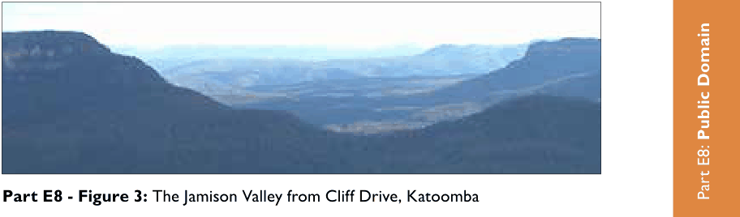
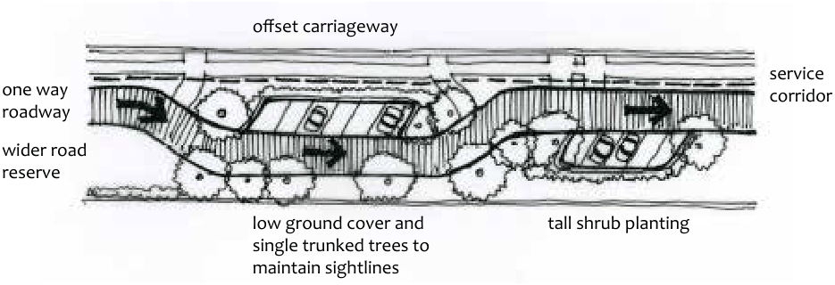

### E8.1.2.	 	Scenic Drives

#### Explanation

The Blue Mountains has a number of scenic drives from Lapstone to Bell, developed over the last 100 years. These are documented in the “Greater Blue Mountains Drive” literature and include roads at:

• Mounts Wilson and Irvine

• Blackheath and Megalong Valley

• Katoomba

• Leura

• Wentworth Falls

• Glenbrook

> [Picture on page 115: a picture, saved as a picture (images/part-e-site-development-and-management-page-115-12.gif, 150 dpi).]
> Words printed on the picture (copied from the PDF):
> Part E8: Public Domain
> Part E8 - Figure 3: The Jamison Valley from Cliff Drive, Katoomba

Probably the most eminent of these is Cliff Drive at Katoomba. Views range from small tree-framed vistas to grand panoramas. Sometimes a series of views lead to a lookout and the progression of views may be a vital part of the streetscape. Scenic drives are usually long established and can be associated with significant heritage values and social history. Any upgrading, construction, landscaping or adjacent development should be consistent with the setting of these drives.

#### Objectives

O1. To retain the balance of scale between the road and natural environment on scenic drives.

O2. To ensure scenic drives retain the historic associations, physical remnants and landscape elements that contribute to their character and history.

O3. To ensure that development adjacent to scenic drives considers the potential impacts upon the values of the scenic drives.

O4. To strengthen the character of the land on the edges and between towns through replanting of indigenous species and vegetation rehabilitation.

O5. To sensitively integrate infrastructure such as stormwater drainage through site appropriate measures.

#### Controls

C1. Construction works associated with major roads and scenic drives that have thickly vegetated roadsides are to include vegetation rehabilitation.

C2. Parking and services are to be unobtrusive and integrated with landscaping;

C3. Construction works associated with scenic drives and lookouts must be low-key and compatible with the natural landscape, including treatments such as:

(a) Planted or grassed swales for stormwater disposal;

(b) Use of compacted earth or stabilised granite in preference to concrete or unit paving;

(c) Reuse of timber and stone from the site in edging, tracks and steps – refer Public Domain Technical Manual.

C4. Stormwater management devices are to be unobtrusive, and utilise materials and finishes in accordance with the Public Domain Technical Manual.

Part E8: Public Domain

C5. Any proposed tourist amenities such as toilets, picnic furniture, shelters and playgrounds are to be constructed of natural materials with natural surface finishes, and carefully sited to be unobtrusive and retain natural views.

C6. Rolled kerbs, plantings, grassed swales and offset parking bays or carriageways are to be used in preference to concrete kerbs and guttering where possible.

> [Picture on page 116: a picture, saved as a picture (images/part-e-site-development-and-management-page-116-26.gif, 150 dpi).]
> Words printed on the picture (copied from the PDF):
> offset carriageway
> tall shrub planting
> low ground cover and
> single trunked trees to
> maintain sightlines

service corridor

one way roadway wider road reserve

Part E8 - Figure 4: An example of offset parking and road.
