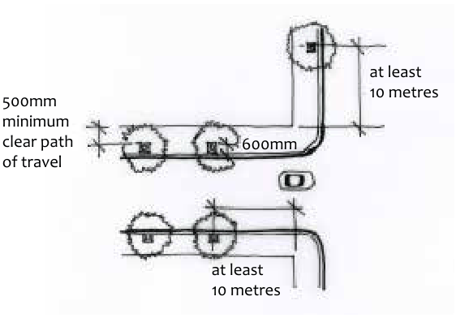
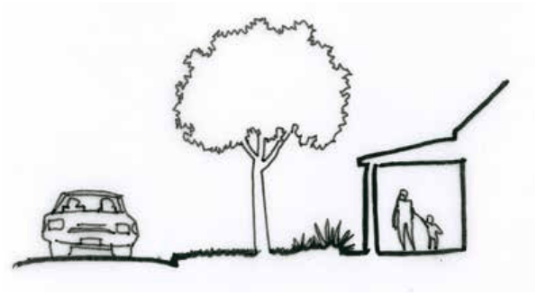

### E8.1.3.	 Town & Village Centre Main Streets

#### Explanation

Part of the special attraction of Blue Mountains towns is, in many cases, the character of their main streets. These streets perform many functions and must work at a practical level. However they also represent the town’s social history, embody its identity to residents and often present a strong town character to visitors. A number of the town centres are protected as heritage conservation areas (reference should be made to Part D Heritage of this DCP) reinforcing the concentration of social and historical significance. Improvements to pedestrian amenity, appearance, accessibility and safety are seen as ways of revitalising, activating and enhancing the character and vitality of the town and village centres which vary in size and significance from village to district centre.

#### Objectives

O1. To ensure that development in town and village centres enhances the public domain and is appropriate to the character of its particular setting;

Part E8: Public Domain

O2. To ensure that development provides a positive interface between public and private realms and that development demonstrates a high level of urban design quality;

O3. To ensure active frontages are provided at main street elevations to enliven the public domain;

O4. To ensure that appropriate materials and furniture are used in publicly accessible areas of town and village centres;

O5. To provide improved amenity, safety and access to town and village centres.

#### Controls

C1. New development, including alterations and additions to existing buildings is to demonstrate a high level of integration between existing and new work. Where a developed materials palette and design approach is evident in the street, this approach should be repeated. Reference should be made to the Council’s Public Domain Technical Manual for materials and finishes.

Where no particular materials palette is evident, pavements, furniture and structural elements are to be provided in accordance with the Council’s Public Domain Technical Manual.

Note: Consultation with Council’s Assets and City Planning Branches should be undertaken prior to the final preparation and lodgement of any application.

C2. Street trees should be provided that are consistent with established themes, and appropriately sized deep soil zones are to be retained for these trees.

Note: Refer to Part C3 Landscaping of this DCP for information on Deep Soil Zones.

C3. Street trees are to be sited to maintain or improve sightlines and to reduce conflicts between pedestrians and cars.

> [Picture on page 118: a picture, saved as a picture (images/part-e-site-development-and-management-page-118-10.gif, 150 dpi).]
> Words printed on the picture (copied from the PDF):
> at least
> 10 metres
> 600mm
> at least
> 10 metres

500mm minimum clear path of travel

Part E8: Public Domain

Part E8 - Figure 5: Position street trees to maintain sightlines

C4. Main Street landscaping is to be simple and robust to minimise maintenance. Combinations of low shrubs or groundcovers to a maximum of 500mm height and street trees which carry their canopy high are preferred to maintain sightlines which are as open as possible.

> [Picture on page 118: a picture, saved as a picture (images/part-e-site-development-and-management-page-118-21.gif, 150 dpi).]

Part E8 - Figure 6: Landscaping to town centre streets: plant combinations must be selected and arranged to keep open sightlines for both safety of pedestrians and personal security.

C5. Weatherproofing in the form of continuous awnings should be provided to all the main street frontages of existing and new shopfront buildings.

C6. Ensure adequate provision and integration of street drainage.

C7. The principles of Crime Prevention through Environmental Design (CPTED) should be applied to all design in the public domain.

Note: Refer to Part E5 Safety and Security for further information.
