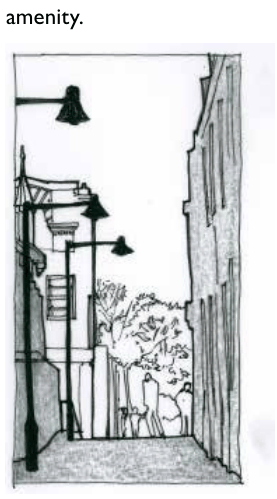

### E8.1.4.	 Town Centre Laneways & Through-Site Links

#### Explanation

Many of the larger town and village shopping centre precincts of the Blue Mountains contain networks of passages and lanes (either external or internal) that allow fine-grain pedestrian access through and around shops, and provide key links to the main street from car parks and residential areas. These can be found in the town centres of Leura, Katoomba, Blackheath, Springwood, Blaxland, Glenbrook, Lawson, Wentworth Falls and Hazelbrook. These laneways offer a different character and experience to the main streets, and can present a legitimate and interesting “back of house” view to the old, often heritage listed Edwardian and Inter-War shopfronts.

Part E8: Public Domain

Through-site links are encouraged where the opportunity arises to integrate other frontages at the rear of shops with the main street. The urban design detailing and activation of lanes and links is to conserve and enhance their character and consolidate their contribution to the functioning of the main centre, by improving permeability while also addressing safety and amenity.

> [Picture on page 119: a picture, saved as a picture (images/part-e-site-development-and-management-page-119-25.gif, 150 dpi).]

Part E8 - Figure 7: Laneways provide a dynamic ‘back of house’ character and experience, in contrast to the main streets

#### Objectives

O1. To identify opportunities for maximising through-site and laneway links.

O2. To achieve a high standard of urban design to town centre laneways which maximises safety, security and general amenity.

O3. To increase activation where possible through flexibility in adjacent floor plan and use of existing and new penetrations to laneway frontages.

O4. To maintain the setting of heritage items and of buildings within a heritage conservation area or adjacent to heritage-listed buildings whilst allowing for an appropriate level of adaptation.

O5. To encourage the inclusion of public art or elements of interest where appropriate to generate activity and through-traffic.

#### Controls

C1. An appropriately qualified and experienced professional such as an architect, landscape architect, or urban designer is to be used to design and detail new development affecting lanes and through-site links;

Part E8: Public Domain

C2. Views in and out of lanes and through-site links are to be maintained. Short, straight runs linking points of existing high activation are to be prioritised and dead ends avoided;

C3. Lighting to new pedestrian lanes and through-links is to:

(a) Be designed by an appropriate lighting engineer;

(b) Comply with AS/NZS 1158.3.1

(c) Be reviewed by the Council’s  Asset Branch where the lanes and links are to become a Council asset.

(d) Should replicate adjacent lighting infrastructure.

C4. New lanes and footpaths and any accompanying street furniture is to be constructed in accordance with the Council’s Public Domain Technical Manual and Design and Construction Specification. If  a developed materials palette is evident, consistency is preferred

C5. Opportunities for artwork should be sought and identified.
