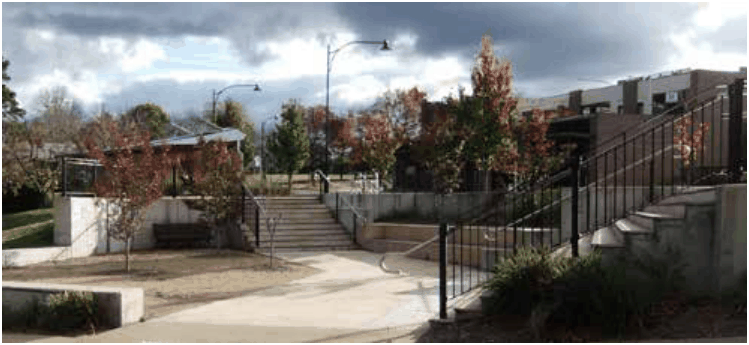

### E8.2. Improving the Public Domain in Town Centres

#### Explanation

The Council’s guiding strategic plan for the City, Sustainable Blue Mountains 2025: Our City Our Future, seeks to strengthen liveability, vibrancy and safety in all town and village centres. Other important qualities of town and village centres listed in this document are retention of character, accessibility, sustainability, vitality and diversity. These qualities are important for both residents and visitors alike. This section aims to provide standards which support these development directions.

Note: In addition to complying with the provisions of this DCP, development in the public domain of town centres must also comply with the principles and provisions of the NSW Disability Inclusion Act 2014.

> [Picture on page 122: a picture, saved as a picture (images/part-e-site-development-and-management-page-122-12.gif, 150 dpi).]

Part E8: Public Domain

Part E8 - Figure 8: Lawson Town Centre
