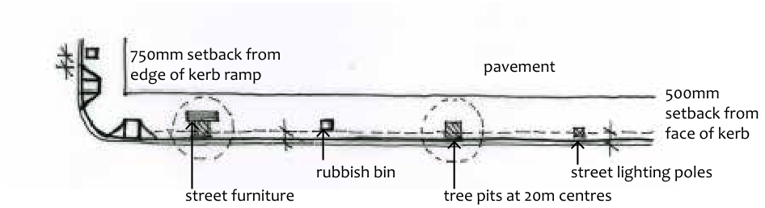

### E8.2.3.	 Street Furniture

#### Explanation

Street furniture includes light poles, signage, seating, bus shelters, garbage bins, planter boxes and balustrades. Where development intersects with the public domain within town centre main streets, careful consideration is to be given to impacts on existing street furniture as well as to any furniture proposed as part of the development. Early consultation will be required with Council’s Assets branch and Urban Designer in relation to street furniture, either existing or proposed. Reference should also be made to the Public Domain Technical Manual.

The range of street furniture listed in Council’s Technical Manual has been carefully selected to be robust, easily maintained with accessible spare parts, and carefully coordinated to balance a contained product range with the need for Blue Mountains towns and villages to display their individual identity.

#### Objectives

O1. Placement and spacing of furniture must relate to functional street requirements and be coordinated with existing street furniture.

O2. Street furniture elements should be set out as part of an integrated streetscape design scheme.

#### Controls

C1. Where new development is likely to impact on existing street furniture and require relocation, this is to be undertaken at the expense of the applicant and in consultation with Council.

C2. Any street furniture proposed as part of a development is to be selected from the range specified in the Public Domain Technical Manual and match any existing street furniture.

Part E8: Public Domain

C3. Street furniture is to be located generally in accordance with the following:

(a) Light poles and signage are to have a minimum of 500mm clearance from the face of kerb; and

(b) Kerbside furniture elements are to be set back from the face of the kerb by 750mm and located so as to provide for a minimum 2m clear path of travel for pedestrians.

> [Picture on page 126: a picture, saved as a picture (images/part-e-site-development-and-management-page-126-25.gif, 150 dpi).]
> Words printed on the picture (copied from the PDF):
> pavement
> 750mm setback from
> edge of kerb ramp
> rubbish bin
> street lighting poles

500mm setback from face of kerb

street furniture

tree pits at 20m centres

Part E8 - Figure 10: Positioning street furniture
