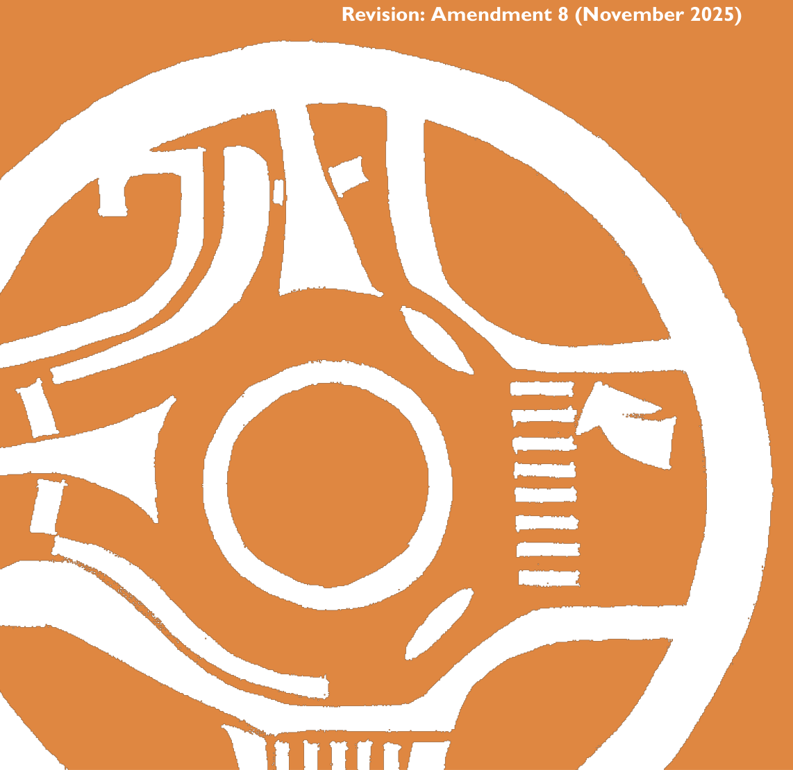

# Blue Mountains Development Control Plan 2015 - Part E Site Development and Management

> This chapter is split into 60 section file(s), one per numbered heading, in the order they appear in the PDF.

Source PDF: [DCP 2015_Amendment 8_Part E.pdf](DCP%202015_Amendment%208_Part%20E.pdf)

### PART E

### SITE DEVELOPMENT AND MANAGEMENT

### Providing appropriate services and facilities with equity and safety

> [Picture on page 1: a picture, saved as a picture (images/part-e-site-development-and-management-page-1-5.gif, 150 dpi).]

#### Revision: Amendment 8 (November 2025)

#### PART E | PAGE 352

### Contents

| Part E1 | Services | 357 |
|---|---|---|
| E1.1. | Requirements for all Development | 360 |
| E1.2. | Wastewater | 362 |
| E1.3. | Telecommunications | 366 |
| E1.4. | Water Supply | 368 |
| E1.5. | Electricity supply | 369 |
| E1.6. | Private Service extensions | 370 |
| Part E2 | Traffic, Parking And Access | 371 |
| E2.1. | Traffic, Parking and Access Objectives | 374 |
| E2.2. | Parking E2.2.1. Traffic and Parking Studies E2.2.2. Vehicle Parking Rates E2.2.3. Parking location and design E2.2.4. Parking requirements for accessible spaces E2.2.5. Service and Delivery Vehicles E2.2.6. Bicycle parking | 375 375 376 383 385 385 386 |
| E2.3. | Access E2.3.1. Public roads E2.3.2. Unformed public roads E2.3.3. Driveways E2.3.4. Pedestrian access E2.3.5. Bicycle access | 388 388 389 390 392 392 |
| E2.4. | Travel Plan | 394 |
| Part E3 | Accessibility, Adaptability And Housing Choice | 395 |
| E3.1. | Accessibility | 398 |
| E3.2. | Adaptability | 400 |
| E3.3. | Housing Choice | 401 |

#### PART E | PAGE 353

| Part E4 | Site Management 403 |
|---|---|
| E4.1. | Protecting amenity 406 |
| E4.2. | Site disturbance 408 |
| E4.3. | Erosion and sediment control 409 |
| E4.4. | Exclusion zones and tree protection during construction 411 |
| E4.5. | Demolition management 413 |
| E4.6. | Decommissioning sewage systems 414 |
| E4.7. | Asbestos 415 |
| Part E5 | Safety And Security 417 |
| E5.1. | Crime minimisation 420 E5.1.1. General provisions for all development 421 E5.1.2. Additional provisions for Multi-dwelling housing, Commercial, Indus- trial and Mixed-use developments 422 |
| E5.2. | Social Impacts 425 |
| E5.3. | Design of food premises 427 |
| E5.4. | Fire safety in buildings 429 |
| Part E6 | Waste Management 433 |
| E6.1. | Waste Management Objectives 436 |
| E6.2. | Waste Management Plan 437 |
| E6.3. | Demolition and construction waste 438 |
| E6.4. | Operational waste management 440 E6.4.1. Low density residential development 440 E6.4.2. Multi dwelling housing 441 E6.4.3. Residential Flat Buildings 443 E6.4.4. Industrial and Commercial 446 E6.4.5. Mixed Use Developments 449 |

#### PART E | PAGE 354

| Part E7 | Contamination | 451 |
|---|---|---|
| E7.1. | Relationship to other Legislation | 454 |
| E7.2. | Contamination investigation | 455 |
| E7.3. | Obtaining contamination information | 457 |
| E7.4. | Independent auditing | 458 |
| Part E8 | Public Domain | 459 |
| E8.1. | Street Hierarchy E8.1.1. Great Western Highway E8.1.2. Scenic Drives E8.1.3. Town & Village Centre Main Streets E8.1.4. Town Centre Laneways & Through-Site Links E8.1.5. Residential Footpaths | 462 463 465 467 469 471 |
| E8.2. | Improving the Public Domain in Town Centres E8.2.1. Footpath Awnings & Balconies E8.2.2. Street Trees E8.2.3. Street Furniture | 472 472 474 475 |
| E8.3. | Cycling Networks | 477 |

#### PART E | PAGE 355

#### PART E | PAGE 356

### Part E1

### SERVICES

### Introduction

Blue Mountains Local Environmental Plan 2015 (LEP 2015) requires that consent is not to be granted to development unless the consent authority is satisfied that a range of services essential for the development are available or that adequate arrangements have been made to make them available when required.

The early consideration of the servicing requirements of a proposal is critical in the design and delivery of good development. The location and capacity of existing services, specific requirements of service authorities, and the location of proposed new infrastructure (such as service main extensions, pumping stations, onsite wastewater disposal systems, hydrant booster valves, electricity substations and the like) can affect the siting and design of the development.

Note: It is recommended that applicants consult with the relevant service authority at the initial stages of the concept planning for a development.

Part E1: Services

#### PART E1 | PAGE 358

#### Read in conjunction with:

#### Part B - Context, Site

#### Analysis and Design

#### All

#### Part C - Environmental

#### Management

#### All

#### Part F - Development

#### Types

#### All

#### Submission requirements:

Part E1: Services

All development:

• A plan showing the location of existing and proposed services, connection points, easements, clearances and access ways.

For development including Onsite wastewater disposal:

• A  Water Cycle Management Study

For development including a Pumpout system:

• Site and Soil Assessment Report

#### PART E1 | PAGE 359

<!-- sections -->
## Sections

1. [E1.1 Requirements for all Development](01-e1-1-requirements-for-all-development.md)
2. [E1.2 Wastewater](02-e1-2-wastewater.md)
3. [E1.3 Telecommunications](03-e1-3-telecommunications.md)
4. [E1.4 Water Supply](04-e1-4-water-supply.md)
5. [E1.5 Electricity supply](05-e1-5-electricity-supply.md)
6. [E1.6 Private Service extensions](06-e1-6-private-service-extensions.md)
7. [E2.1 Traffic, Parking and Access Objectives](07-e2-1-traffic-parking-and-access-objectives.md)
8. [E2.2 Parking](08-e2-2-parking.md)
9. [E2.2.1 Traffic and Parking Studies](09-e2-2-1-traffic-and-parking-studies.md)
10. [E2.2.2 Vehicle Parking Rates](10-e2-2-2-vehicle-parking-rates.md)
11. [E2.2.3 Parking location and design](11-e2-2-3-parking-location-and-design.md)
12. [E2.2.4 Parking requirements for accessible spaces](12-e2-2-4-parking-requirements-for-accessible.md)
13. [E2.2.5 Service and Delivery Vehicles](13-e2-2-5-service-and-delivery-vehicles.md)
14. [E2.2.6 Bicycle parking](14-e2-2-6-bicycle-parking.md)
15. [E2.3 Access](15-e2-3-access.md)
16. [E2.3.1 Public roads](16-e2-3-1-public-roads.md)
17. [E2.3.2 Unformed public roads](17-e2-3-2-unformed-public-roads.md)
18. [E2.3.3 Driveways](18-e2-3-3-driveways.md)
19. [E2.3.4 Pedestrian access](19-e2-3-4-pedestrian-access.md)
20. [E2.3.5 Bicycle access](20-e2-3-5-bicycle-access.md)
21. [E2.4 Travel Plan](21-e2-4-travel-plan.md)
22. [E3.1 Accessibility](22-e3-1-accessibility.md)
23. [E3.2 Adaptability](23-e3-2-adaptability.md)
24. [E3.3 Housing Choice](24-e3-3-housing-choice.md)
25. [E4.1 Protecting amenity](25-e4-1-protecting-amenity.md)
26. [E4.2 Site disturbance](26-e4-2-site-disturbance.md)
27. [E4.3 Erosion and sediment control](27-e4-3-erosion-and-sediment-control.md)
28. [E4.4 Exclusion zones and tree protection during](28-e4-4-exclusion-zones-and-tree-protection.md)
29. [E4.5 Demolition management](29-e4-5-demolition-management.md)
30. [E4.6 Decommissioning sewage systems](30-e4-6-decommissioning-sewage-systems.md)
31. [E4.7 Asbestos](31-e4-7-asbestos.md)
32. [E5.1 Crime minimisation](32-e5-1-crime-minimisation.md)
33. [E5.1.1 General provisions for all development](33-e5-1-1-general-provisions-for-all-development.md)
34. [E5.2 Social Impacts](34-e5-2-social-impacts.md)
35. [E5.3 Design of food premises](35-e5-3-design-of-food-premises.md)
36. [E5.4 Fire safety in buildings](36-e5-4-fire-safety-in-buildings.md)
37. [E6.1 Waste Management Objectives](37-e6-1-waste-management-objectives.md)
38. [E6.2 Waste Management Plan](38-e6-2-waste-management-plan.md)
39. [E6.3 Demolition and construction waste](39-e6-3-demolition-and-construction-waste.md)
40. [E6.4.1 Low density residential development](40-e6-4-1-low-density-residential-development.md)
41. [E6.4.2 Multi dwelling housing](41-e6-4-2-multi-dwelling-housing.md)
42. [E6.4.3 Residential Flat Buildings](42-e6-4-3-residential-flat-buildings.md)
43. [E6.4.4 Industrial and Commercial](43-e6-4-4-industrial-and-commercial.md)
44. [E6.4.5 Mixed Use Developments](44-e6-4-5-mixed-use-developments.md)
45. [E7.1 Relationship to other Legislation](45-e7-1-relationship-to-other-legislation.md)
46. [E7.2 Contamination investigation](46-e7-2-contamination-investigation.md)
47. [E7.3 Obtaining contamination information](47-e7-3-obtaining-contamination-information.md)
48. [10.7 Planning Certificates](48-10-7-planning-certificates.md)
49. [E7.4 Independent auditing](49-e7-4-independent-auditing.md)
50. [E8.1 Street  Hierarchy](50-e8-1-street-hierarchy.md)
51. [E8.1.1 Great Western Highway](51-e8-1-1-great-western-highway.md)
52. [E8.1.2 Scenic Drives](52-e8-1-2-scenic-drives.md)
53. [E8.1.3 Town & Village Centre Main Streets](53-e8-1-3-town-and-village-centre-main-streets.md)
54. [E8.1.4 Town Centre Laneways & Through-Site Links](54-e8-1-4-town-centre-laneways-and-through-site.md)
55. [E8.1.5 Residential Footpaths](55-e8-1-5-residential-footpaths.md)
56. [E8.2 Improving the Public Domain in Town Centres](56-e8-2-improving-the-public-domain-in-town.md)
57. [E8.2.1 Footpath Awnings & Balconies](57-e8-2-1-footpath-awnings-and-balconies.md)
58. [E8.2.2 Street Trees](58-e8-2-2-street-trees.md)
59. [E8.2.3 Street Furniture](59-e8-2-3-street-furniture.md)
60. [E8.3 Cycling Networks](60-e8-3-cycling-networks.md)
