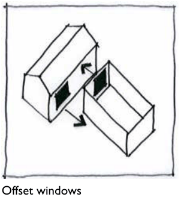
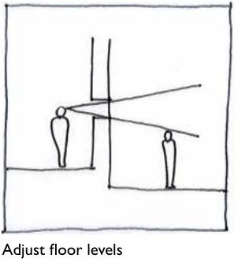
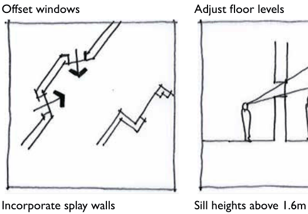
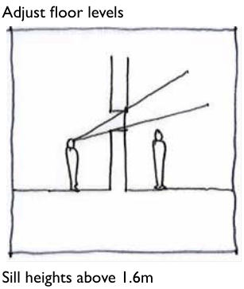

### F1.1.2.	 Visual privacy

#### Explanation

Low density residential development should be designed to optimise visual privacy by minimising overlooking and cross viewing to adjoining dwellings. Complete visual privacy is often difficult to achieve in the urban context and is not necessarily desirable. Some level of cross viewing between properties is beneficial as this serves to improve security through passive surveillance.

Note: Council’s assessment of development applications is guided by Land and Environment Court Planning Principles. In the case of privacy Council may refer to the Planning Principle established in Meriton v Sydney City Council [2004] NSWLEC 313 to guide the decision making process.

#### Objectives

O1. To ensure that low-density residential development is designed to provide a reasonable level of privacy for dwellings and to protect the privacy of adjacent and nearby properties.

#### Controls

C1. The location, scale and design of a dwelling house or secondary dwelling shall ensure that the visual privacy of residents of buildings on adjoining allotments is not significantly impacted upon.

C2. Direct views from a dwelling house or secondary dwelling into the principal private open spaces or habitable rooms of dwellings on adjoining allotments are to be minimised or effectively screened.

Note: Part F1 - Figure 1 illustrates some of the design approaches that may be incorporated into development to minimise direct views of private open spaces or habitable rooms of dwellings on adjoining allotments.

> [Picture on page 12: a picture, saved as a picture (images/part-f-development-types-page-12-11.gif, 150 dpi).]

> [Picture on page 12: a picture, saved as a picture (images/part-f-development-types-page-12-12.gif, 150 dpi).]

Offset windows

> [Picture on page 12: a picture, saved as a picture (images/part-f-development-types-page-12-14.gif, 150 dpi).]

Adjust floor levels

> [Picture on page 12: a picture, saved as a picture (images/part-f-development-types-page-12-16.gif, 150 dpi).]

Part F1: Residential Development

Incorporate splay walls

Sill heights above 1.6m

Part F1 – Figure 1: Design approaches to minimise direct views. Source: AMCORD

C3. A privacy screen must be provided for any part of a window to a habitable room that is less than 1.5m above the finished floor level of that room if –

(a) The window faces and is less than 3m from a side or rear boundary and the room has a finished floor level of more than 1m above ground level (existing), or

(b) The window faces and is at least 3m but not more than 6m, from a side or rear boundary and the room has a finished floor level of more than 3m above ground level (existing).

C4. Proposed habitable room windows of a dual occupancy with a direct outlook to habitable room windows or private open space of an adjacent dwelling are to have a separation distance of no less than 6m.

C5. Where proposed habitable room windows of a dual occupancy will have a direct outlook to habitable room windows or private open space of an adjacent dwelling and are separated by less than 9m, the window shall:

(a) be offset a minimum of 1m from the edge of the proposed window to the edge of the existing window, or

(b) have sill heights of at least 1.6m above floor level, or

(c) have fixed obscure glazing applied to any part of the window below 1.6m above floor level.

Part F1: Residential Development

C6. Overlooking from or to private open space areas is to be reduced by ensuring that second storey elements of a dwelling, secondary dwelling or dual occupancy are designed and screened to minimise the potential for overlooking of the private open space of adjoining dwellings.

C7. Where potential overlooking from a dwelling, secondary dwelling or dual occupancy cannot be avoided, views of private open space areas may be obscured in the following ways:

(a) by solid translucent screens or perforated panels or trellises, which have a maximum of 30% openings and that are designed to blend in with the proposed redevelopment, and are to be permanent components of the structure and difficult to alter,

(b) by retention or planting of dense mature vegetation on the development site, if used in conjunction with C7 (a).

C8. The setback between shared driveways or access ways (including a right of carriageway) and the habitable room windows of a dwelling is to be no less than 1.5m.
