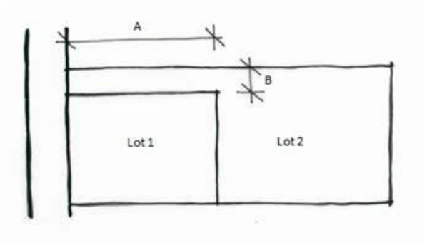
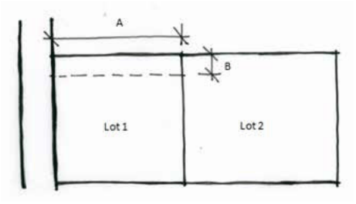

#### R2 Low Density Residential, Zone C3 Environmental

Management and Zone C4 Environmental Living are able to accommodate a minimum 150m2  area for private open space that:

(a) is at least 10m wide or deep, and

(b) is not Environmentally Sensitive Land, and

(c) does not contain land steeper than 10% slope, and

(d) is located behind the building envelope specified in control C5, and

(e) can be readily accessed on foot from the building envelope.

Part F5: Subdivision and Consolidation

C8. New allotments are to comply with the minimum lot widths prescribed in Part F5 - Table 1. Lot widths are measured at the relevant building setback as specified in the DCP or LEP.

Part F5 - Table 1: Minimum lot widths for new allotments.

| Zone | Minimum lot width |
|---|---|
| R1 General Residential | 18.5m |
| R2 Low Density Residential | 18.5m |
| R3 Medium Density Residential | 18.5m |
| E4 General Industrial | 18.5m |
| C3 Environmental Management | 30m |
| C4 Environmental Living | 22m |

C9. In other zones, the allotment widths are to be such that the lot is fit for purpose.

C10. The ratio between lot width to depth is to be between 1:1 and 1:4 within Zone R1 General Residential, Zone R2 Low Density Residential, Zone R3 Medium Density Residential, and Zone C4 Environmental Living.

C11. Subdivision of large sites for residential development should allow for a range of lot sizes to suit a mix of housing types and sizes.

C12. All lots are to be capable of legally and practically draining stormwater to a public road, a public drainage system or a natural watercourse. Where lots slope away from a public road and do not contain a public drainage system or a watercourse, piped interallotment drainage easements are to be provided over the downhill allotments to facilitate appropriate drainage to a public road, a public drainage system or a natural watercourse.

C13. Private interallotment drainage easements must be a minimum of 1m in width to enable ongoing maintenance access.

C14. All road, access and drainage design and easements are to:

(a) be in accordance with the Council’s Design and Construction Specification; and

(b) comply with the Council’s Public Domain Technical Manual Specification within town centres; and

(c) comply with the NSW Rural Fire Service document Planning for Bush Fire Protection in bush fire prone areas.

Part F5: Subdivision and Consolidation

C15. All services are to be installed underground where new roads are created or existing roads are extended as part of the subdivision.

Battleaxe allotments

C16. For the purpose of Controls C15 to C19, a ‘battleaxe allotment’ is a lot proposed in a subdivision that relies on an access handle or a right of carriageway for the provision of access to a public road.

C17. The area of the battleaxe handle is excluded from the minimum lot area calculation for a battleaxe allotment as per Part F5 - Figure 1.

C18. Where a battleaxe allotment is accessed via a right of carriageway, the area and width of the right of carriageway is excluded from the minimum area and width calculations on the burdened lot as per Part

F5 - Figure 2.

C19. Notwithstanding C17, the area and width of the right of carriageway is included in the minimum area and width calculations on the burdened lot only if that right-of-carriageway will provide the sole vehicular access for a dwelling on the burdened lot.

> [Picture on page 98: a picture, saved as a picture (images/part-f-development-types-page-98-1.gif, 150 dpi).]

Part F5 - Figure 1: Calculating the minimum area of a battleaxe allotment (Lot 2); the battleaxe handle area (A x B) is to be excluded from Lot 2.

> [Picture on page 98: a picture, saved as a picture (images/part-f-development-types-page-98-5.gif, 150 dpi).]

Part F5: Subdivision and Consolidation

Part F5 - Figure 2: Calculating the minimum area and width of a lot burdened by a right of carriageway to a battleaxe allotment; the right of carriageway area (A x B) and width (B) is to be excluded from Lot 1 where vehicle access to Lot 1 is located outside the right of carriageway.

C20. A handle to a battleaxe allotment is to:

(a) have a passing bay approximately at mid length where the handle is longer than 50m, and

(b) serve a maximum of 3 allotments, and

(c) be a minimum of 4.5m wide where accessing a single allotment, and

(d) be a minimum of 6m wide where serving more than 1 allotment.

Strata subdivisions

C21. The strata titling of commercial and industrial development and affordable housing is discouraged as it may restrict the future redevelopment potential of the site by having multiple different owners.

C22. Within a strata or community title subdivision, parking spaces and spaces used for other purposes (e.g.: storage) that are associated with an individual unit are to be included in the same allotment as the unit.

C23. Landscaping, communal open space, access areas, services areas and directory board signage, where not part of an individual unit in a strata subdivision, are to be designated as common property.

Part F5: Subdivision and Consolidation
