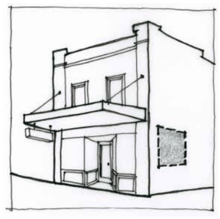

### F6.2.2.	 Wall signs

A wall sign is defined as a business identification sign (including a business identification sign for a home business) that is flat mounted or painted on the exterior wall of an existing building, or on an existing boundary fence or wall.

Note: Wall signs may be exempt development pursuant to State Environmental Planning Policy (Exempt and Complying Development Codes) 2008 (Codes SEPP).

> [Picture on page 112: a picture, saved as a picture (images/part-f-development-types-page-112-3.gif, 150 dpi).]

Part F6 - figure 1: suitable location for a wall sign

#### Controls

C1. Subject to C2, wall signs are to accord with each of the design requirements prescribed in Part F6 - Table 2:

Part F6 - Table 2: Design requirements for wall signs

| Element | Standard |  |
|---|---|---|
| Maximum No. | One (1) per elevation up to a maximum of 3. |  |
| of signs |  |  |
| Maximum area | E1 Local Centre , E2 | • 5m2 |
| (per sign) | Commercial Centre |  |
|  | E4 General Industriall | • 16m2 if attached or fixed |
|  |  | to a building or 20% of the |
|  |  | surface area of the wall if |
|  |  | painted or applied by ad- |
|  |  | hesive material |
|  | All other zones | • A sign for a home business, |
|  |  | home industry or home occupation - 1m2 |
|  |  | • A sign for any other use - 2.5m2 |
| Installation | Flat mounted or painted against exterior wall of exist- ing building or boundary fence or wall |  |
| Maximum | Not to project beyond the parapet or eaves of the |  |
| projection | building to which the sign is attached |  |
| Illumination | Permitted if not animated, flashing or moving |  |

Part F6: Signage

C2. Wall signs that do not accord with the design requirements prescribed in C1 will be assessed on the merits of the proposal and are to demonstrate:

(a) compatibility with the existing or desired future character of an area, and

(b) contribution to visual interest of the streetscape or setting, and

(c) compatibility with scale, proportion and other characteristics of the building or site on which the signage is proposed to be located, and

(d) rationalisation of existing signage and the minimisation of visual and physical clutter.
