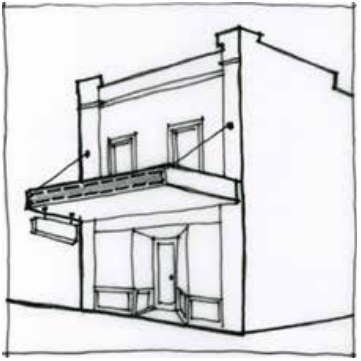

### F6.2.3.	 Fascia signs

A fascia sign is defined as a business identification sign on the existing fascia of the awning of a building.

Note: Fascia signs may be exempt development pursuant to State Environmental Planning Policy (Exempt and Complying Development Codes) 2008 (Codes SEPP).

> [Picture on page 113: a picture, saved as a picture (images/part-f-development-types-page-113-17.gif, 150 dpi).]

Part F6: Signage

Part F6 - Figure 2: suitable location for a fascia sign

#### Controls

C1. Subject to C2, fascia signs are to accord with each of the design requirements prescribed in Part F6 - Table 3:

Part F6 - Table 3: Design requirements for fascia signs

| Element | Standard |
|---|---|
| Installation | Flat mounted or painted and securely fixed to the fascia |
| Maximum projection | Not project below, above or beyond the sides of the fascia |
| Location | 600mm behind the alignment of any kerb in the adjacent road |
| Illumination | Must not be illuminated |

C2. Fascia signs that do not accord with the design requirements prescribed in C1 are unlikely to be supported however will be assessed on the merits of the proposal, and are to demonstrate:

(a) compatibility with the existing or desired future character of an area, and

(b) compatibility with scale, proportion and other characteristics of the building or site on which the signage is proposed to be located.

Part F6: Signage
