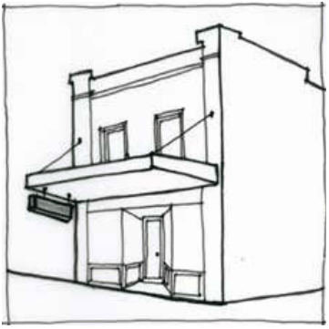

### F6.2.4.	 Under awning signs

An under awning sign is defined as a business identification sign suspended below the existing awning of a building.

Note: Under awning signs may be exempt development pursuant to State Environmental Planning Policy (Exempt and Complying Development Codes) 2008 (Codes SEPP).

> [Picture on page 114: a picture, saved as a picture (images/part-f-development-types-page-114-16.gif, 150 dpi).]

Part F6 - Figure 3: suitable location for an under-awning sign

#### Controls

C1. Subject to C2, under awning signs are to accord with each of the design requirements prescribed in Part F6 - Table 4:

Part F6 - Table F4: Design requirements for under awning signs

| Element | Standard |
|---|---|
| Maximum No. of signs | One (1) per ground floor tenancy. 2 under awning signs permitted where a tenancy is situated on a corner allotment and has a front- age to both streets. |
| Maximum area (per | 1.5m2 |
| sign) |  |
| Maximum dimensions | 2.5m in length |
| Installation | Suspended at a right angle to the building with lower edge 2.6m above ground level (existing) |
| Maximum projection | Not to project beyond the awning fascia |
| Illumination | Permitted if not animated, flashing or moving |

Part F6: Signage

C2. Under awning signs that do not accord with the design requirements prescribed in C1 are unlikely to be supported however will be assessed on the merits of the proposal and are to demonstrate:

(a) rationalisation of existing signage, and/or the minimisation of visual and physical clutter, and

(b) appropriate clearance such that the proposal will not compromise pedestrian safety.
