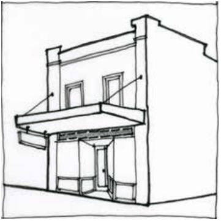

### F6.2.5.	 Top hamper signs

A top hamper sign is defined as a business identification sign above a display window or attached to the transom of a doorway in an existing building.

Note: Top hamper signs may be exempt development pursuant to State Environmental Planning Policy (Exempt and Complying Development Codes) 2008 (Codes SEPP).

> [Picture on page 116: a picture, saved as a picture (images/part-f-development-types-page-116-1.gif, 150 dpi).]

Part F6 - Figure 4: suitable location for a top hamper sign

#### Controls

C1. Subject to C2, top hamper signs are to accord with each of the design requirements prescribed in Part F6 - Table 5:

Part F6 - Table 5: Design requirements for top hamper signs

| Element | Standard |
|---|---|
| Maximum No. of signs | One (1) per ground floor tenancy. |
| Maximum area (per sign) | 2.5m2 |
| Maximum dimensions | 600mm in height |
| Installation | Fixed flush to the transom |
| Maximum projection | Not to project below the transom of the doorway |
| Illumination | Permitted if not animated, flashing or moving |

Part F6: Signage

C2. Top hamper signs that do not accord with the design requirements prescribed in C1 will be assessed on the merits of the proposal and are to demonstrate:

(a) compatibility with the existing or desired future character of an area, and

(b) compatibility with scale, proportion and other characteristics of the building or site on which the signage is proposed to be located, and

(c) rationalisation of existing signage and the minimisation of visual and physical clutter.
