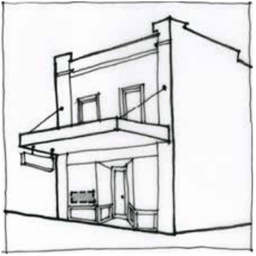

### F6.2.6.	 Window signs

A window sign is defined as a business identification sign inside any window of an existing building and includes adhesive window decals commonly referred to as ‘lifestyle’ graphics.

Note: Window signs may be exempt development pursuant to State Environmental Planning Policy (Exempt and Complying Development Codes) 2008 (Codes SEPP).

> [Picture on page 117: a picture, saved as a picture (images/part-f-development-types-page-117-7.gif, 150 dpi).]

Part F6 - Figure 5: suitable location for a window sign

#### Controls

Part F6: Signage

C1. Subject to C2, window signs and decals are to accord with each of the design requirements prescribed in Part F6 - Table 6:

Part F6 - Table 6: Design requirements for window signs

| Element | Standard |
|---|---|
| Maximum area | Not cover more than 20% of the surface of the win- dow in which it is displayed or 6m2, whichever is the lesser |
| Location | Must not unreasonably obstruct existing or potential sight lines between the interior of a premise and the public domain, or compromise active street frontages. Consideration will be given to privacy requirements. |
| Illumination | Must not be illuminated |

C2. Window signs that do not accord with the design requirements prescribed in C1 will be assessed on the merits of the proposal and are to demonstrate:

(a) compatibility with the existing or desired future character of an area, and

(b) compatibility with scale, proportion and other characteristics of the building or site on which the signage is proposed to be located.
