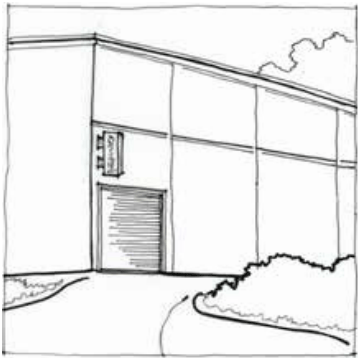

### F6.2.9.	 Projecting wall sign

A projecting wall sign is defined as a business identification sign that projects from the exterior wall of an existing building.

Note: Projecting wall signs may be complying development pursuant to State Environmental Planning Policy (Exempt and Complying Development Codes) 2008 (Codes SEPP).

> [Picture on page 120: a picture, saved as a picture (images/part-f-development-types-page-120-1.gif, 150 dpi).]

Part F6 - Figure 6: suitable location for a projecting wall sign

#### Controls

C1. Subject to C2, projecting wall signs are to accord with each of the design requirements prescribed in Part F6 - Table 9:

Part F6 - Table 9: Design requirements for projecting wall signs

Part F6: Signage

Part F6: Signage

| Element | Standard |
|---|---|
| Generally not | RU2 Rural Landscape, RU4 Primary Production Small |
| acceptable | Lots, R2 Low Density Residential, R3 Medium Density |
| within the | Residential, C2 Environmental Conservation, C3 |
| following zones | Environmental Management, C4 Environmental Living |
| Location | 600mm behind the alignment of any kerb in the adja- cent road |
| Maximum No. | One (1) per elevation to a maximum of 3. Multiple |
| of signs | projecting wall signs on the same elevation will be considered for premises with multiple commercial tenants within Zone E4 General Industrial |
| Maximum area (per sign) | E4 General Industrial 2.5m2 E1 Local Centre. 1.5m2 E2 Commercial Centre, RE1 Public Recreation, RE2 Private Recreation, R1 General Residential, SP3 Tourist |
| Maximum | E4 General Industrial • Not to project more |
| projection | than 1.5m horizontally from wall of building • Not to project beyond the parapet or eaves E1 Local Centre, • Not to project E2 Commercial Centre more than 0.75m RE1 Public Recreation, horizontally from wall RE2 Private Recreation, of building R1 General Residential, SP3 Tourist • Not to project beyond the parapet or eaves |
| Installation | Suspended at a right angle to the building with lower edge 2.6m above ground level (existing) |
| Illumination | Illuminated only during approved operating hours |

C2. Projecting wall signs that do not accord with the design requirements prescribed in C1 will be assessed on the merits of the proposal and are to demonstrate:

(a) compatibility with the existing or desired future character of an area, and

(b) contribution to visual interest of the streetscape or setting, and

(c) compatibility with scale, proportion and other characteristics of the building or site on which the signage is proposed to be located, and

(d) rationalisation of existing signage and the minimisation of visual and physical clutter.
