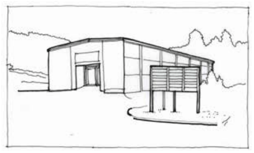
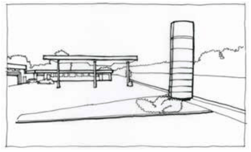

### F6.2.10.	 Freestanding pylon and directory board signs

A freestanding pylon or directory board sign is defined as a business identification sign that is displayed on a freestanding structure that is mounted on the ground on one or more supports.

Note: Freestanding pylon and directory board signs may be complying development pursuant to State Environmental Planning Policy (Exempt and Complying Development Codes) 2008 (Codes SEPP).

> [Picture on page 122: a picture, saved as a picture (images/part-f-development-types-page-122-13.gif, 150 dpi).]

Part F6: Signage

Part F6 - Figure 7: suitable location for a freestanding directory board sign

> [Picture on page 122: a picture, saved as a picture (images/part-f-development-types-page-122-17.gif, 150 dpi).]

Part F6 - Figure 8: suitable location for a freestanding pylon sign

#### Controls

C1. Subject to C2, freestanding pylon and directory board signs are to accord with each of the design requirements prescribed in Part F6 - Table 10:

Part F6 - Table 10: Design requirements for freestanding pylon and directory board signs

| Element | Standard | |
|---|---|---|
| Generally not acceptable within the following zones | RU2 Rural Landscape, RU4 Primary Production Small Lots, R1 General Residential, R2 Low Density Residential, R3 Medium Density Residential, C2 Environmental Conservation, C3 Environmental Management, C4 Environmental Living | |
| Location | Wholly within site boundaries in a location that does not obstruct the sight lines of, or interfere with, any traffic control device, including traffic control lights | |
| Maximum No. of signs | One (1) per street frontage provided the frontage is more than 15m in width | |
| Maximum dimensions | E4 General Industrial, E1 LocalCentre, E2 Commercial Centre | 6m in height |
| | RE1 Public Recreation, RE2 Private Recreation, SP3 Tourist | 3m in height |
| Maximum area (per sign) | E4 General Industria, E1 Local Centre, E2 Commercial Centre | • 8m2 if the sign relates to a premises with a single commercial tenant • 16m2 if the sign relates to a premise with multiple commercial tenants |
| | RE1 Public Recreation, RE2 Private Recreation, SP3 Tourist | 4.5m2 |
| Illumination | Illuminated only during approved operating hours | |

Part F6: Signage

C2. Freestanding pylon and directory board signs that do not accord with the design requirements prescribed in C1 are unlikely to be supported however will be assessed on the merits of the proposal and are to demonstrate:

(a) compatibility with the existing or desired future character of an area, and

(b) contribution to visual interest of the streetscape or setting, and

(c) appropriate positioning so as not to compromise vehicular or pedestrian safety by obscuring sightlines.
