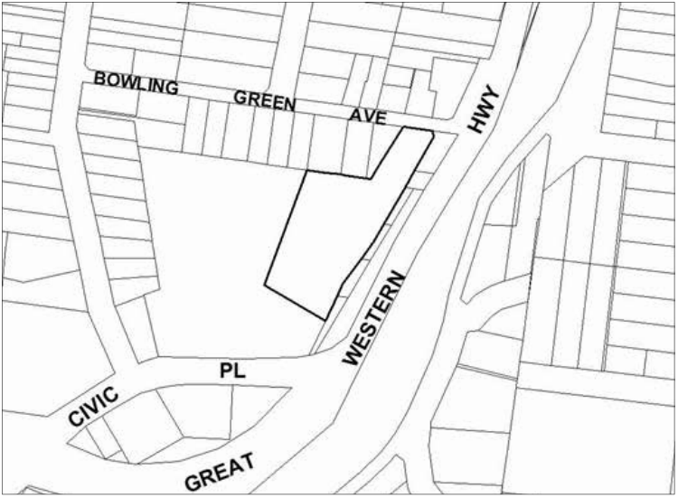
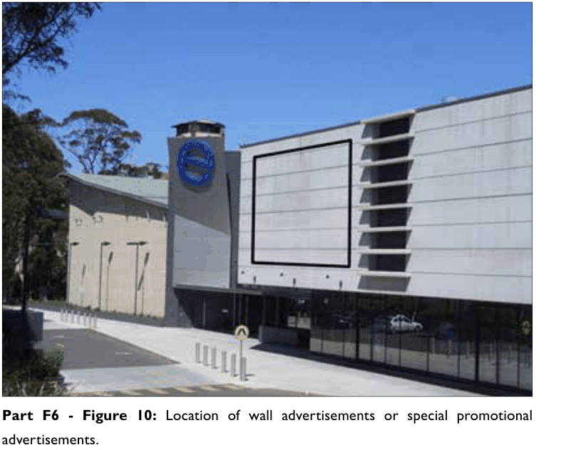

### F6.3.1.	 The Edge Cinema

This part applies to “The Edge” cinema located at Lot 1 DP848603, 225–237 Great Western Highway, Katoomba.

> [Picture on page 124: a picture, saved as a picture (images/part-f-development-types-page-124-7.gif, 150 dpi).]

Part F6: Signage

Part F6 - Figure 9: The Edge Cinema

#### Permitted signage

• A wall advertisement is an advertisement that is generally painted on or

fixed flat to the wall of a building.

• A special promotional advertisement is an advertisement for an activity or

event of a civic or community nature.

Note: The provisions and controls contained in this part are to be read in conjunction with the Transport Corridor Outdoor Advertising and Signage Guidelines 2007 (Guidelines). Outdoor advertising formats are defined in the Guidelines.

#### Controls

C1. Wall advertisements or special promotional advertisements are to be located within the area shown in Part F6 - Figure 10.

C2. Wall advertisements or special promotional advertisements are to have a maximum area of 85m2 and a minimum area of 45m2.

Note: The display of an advertisement that has an area greater than 20m2 or that is higher than 8m above the ground is advertised development for the purposes of the EP&A Act.

C3. The content of wall advertisements is restricted to information relating to events and movies held at “the Edge” cinema.

C4. The display of a special promotional advertisement is limited in time to a total of 3 months in any 12 month period.

C5. Should there be more than one sign erected, signage must be integrated as one panel or coordinated in terms of size and location.

C6. Signage may take the form of banners attached to the wall or images projected onto a screen which is securely fixed to the wall.

C7. Any light projections or illumination of signage must comply with the Transport Corridor Outdoor Advertising and Signage Guidelines, July 2007.

> [Picture on page 125: a picture, saved as a picture (images/part-f-development-types-page-125-14.gif, 150 dpi).]
> Words printed on the picture (copied from the PDF):
> Part F6 - Figure 10: Location of wall advertisements or special promotional

Part F6: Signage

advertisements.
