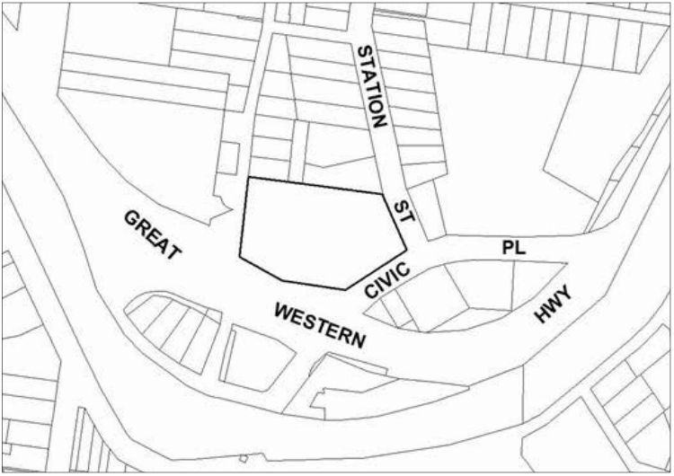
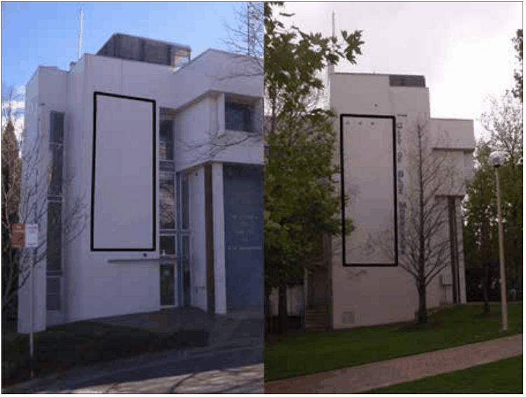

### F6.3.2.	 BMCC Headquarters

This part applies to the Blue Mountains City Council Headquarters building, located at Lot 1 DP705910 – 2 – 6 Civic Place, Katoomba.

> [Picture on page 126: a picture, saved as a picture (images/part-f-development-types-page-126-4.gif, 150 dpi).]

Part F6 - Figure 11: BMCC Headquarters

Part F6: Signage

#### Permitted signage

• A special promotional advertisement is an advertisement for an activity or

event of a civic or community nature.

Note: The provisions and controls contained in this part are to be read in conjunction with the Transport Corridor Outdoor Advertising and Signage Guidelines 2007 (Guidelines). Outdoor advertising formats are defined in the Guidelines.

#### Controls

C1. Special promotional advertisements are to be located within the areas shown in Part F6 - Figure12.

C2. Maximum area of special promotional advertisement signs is 25m2.

Note: The display of an advertisement that has an area greater than 20m2 or that is higher than 8m above the ground is advertised development for the purposes of the EP&A Act.

C3. Special promotional advertisements are to be consistent with Council’s Public Art Policy.

C4. Should there be more than one sign erected, signage must be integrated as one panel or coordinated in terms of size and location.

C5. Signage may take the form of banners attached to the wall or images projected onto a screen which is securely fixed to the wall.

C6. Any light projections or illumination of signage must comply with the Transport Corridor Outdoor Advertising and Signage Guidelines, July 2007.

> [Picture on page 127: a picture, saved as a picture (images/part-f-development-types-page-127-5.gif, 150 dpi).]

Part F6: Signage

Part F6 - Figure 12: Location of special promotional advertisements.

Part F6: Signage

### Part F7

### OTHER DEVELOPMENT

### Introduction

This part provides objectives and controls for particular types of development. These development types may have site specific requirements or ,simply due to the nature of the development, require separate consideration.

To the extent of any inconsistency between this section and any other DCP sections, this section will prevail.

Part F7: Other Development

#### PART F7 | PAGE 608

#### Read in conjunction with:

#### Part C - Environmental

#### Management

#### All

#### Part E - Site Development

and Management

#### All

#### Part F - Specific

#### Development Types

#### All

#### Relationship to other legislation:

Part F7: Other Development

• State Environmental Planning Policy (Exempt and Complying Codes) 2008

#### PART F7 | PAGE 609
