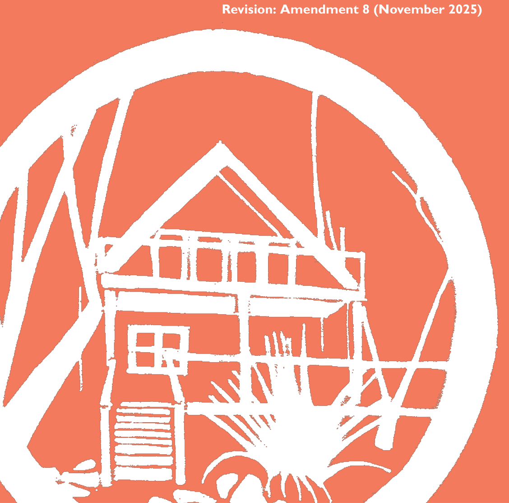

# Blue Mountains Development Control Plan 2015 - Part F Development Types

> This chapter is split into 91 section file(s), one per numbered heading, in the order they appear in the PDF.

Source PDF: [DCP 2015_Amendment 8_Part F.pdf](DCP%202015_Amendment%208_Part%20F.pdf)

### PART F

### SPECIFIC

### DEVELOPMENT TYPES

### Additional provisions for certain types of development

#### Revision: Amendment 8 (November 2025)

> [Picture on page 1: a picture, saved as a picture (images/part-f-development-types-page-1-6.gif, 150 dpi).]

#### PART F | PAGE 480

### Contents

| Part F1 | Residential Development |  | 485 |
|---|---|---|---|
| F1.1. | Low Density Residential |  | 488 |
|  | F1.1.1. | Private open space | 488 |
|  | F1.1.2. | Visual privacy | 489 |
|  | F1.1.3. | Acoustic Privacy | 491 |
|  | F1.1.4. | Sunlight access | 492 |
|  | F1.1.5. | Views | 493 |
|  | F1.1.6. | Driveways and parking | 494 |
|  | F1.1.7. | Dual occupancy | 496 |
|  | F1.1.8. | Secondary dwellings | 498 |
| F1.2. | Medium Density Residential |  | 500 |
|  | F1.2.1. | Building articulation and separation | 500 |
|  | F1.2.2. | Private open space | 501 |
|  | F1.2.3. | Communal open space | 503 |
|  | F1.2.4. | Landscaping | 504 |
|  | F1.2.5. | Visual privacy | 505 |
|  | F1.2.6. | Acoustic privacy | 506 |
|  | F1.2.7. | Sunlight access | 507 |
|  | F1.2.8. | Views | 509 |
|  | F1.2.9. | Driveways and parking | 509 |
| F1.3. | Ancillary Development |  | 512 |
|  | F1.3.1. | Fences | 512 |
|  | F1.3.2. | Detached studios | 514 |
|  | F1.3.3. | Outbuildings | 515 |
|  | F1.3.4. | Swimming pools and spas | 516 |
|  | F1.3.5. | Tennis Courts | 518 |

#### PART F | PAGE 481

| Part F2 | Retail and Commercial Development | 519 |
|---|---|---|
| F2.1. | Building Design and Site Planning | 522 |
| F2.2. | Parking and Access F2.2.1. Exceptions to parking rates | 523 525 |
| F2.3. | Landscaping for parking areas | 527 |
| F2.4. | Amenity F2.4.1. Operational Noise and Odour F2.4.2. Sunlight access F2.4.3. Views | 529 529 530 531 |
| Part F3 | Industrial Development | 533 |
| F3.1. | Building Design and Site Planning | 536 |
| F3.2. | Driveways and Parking | 537 |
| F3.3. | Landscaping for parking areas | 539 |
| F3.4. | Amenity and Privacy | 541 |
| F3.5. | Industrial Ancillary Development F3.5.1. Industrial Retail Outlets F3.5.2. Dwellings (Caretaker’s residence) | 544 544 544 |
| Part F4 | Tourist Development | 547 |
| F4.1. | General objectives for all Visitor and Tourist Accommodation | 550 |
| F4.2. | Bed & Breakfast Accommodation, and Farm Stay Accommodation |  |
|  |  | 551 |
|  | F4.2.1. Site Planning and Bush fire requirements | 551 |
|  | F4.2.2. Parking and Access | 552 |
|  | F4.2.3. Amenity | 553 |
|  | F4.2.4. Sunlight Access | 554 |
|  | F4.2.5. Services | 554 |

#### PART F | PAGE 482

| F4.3. | Hotel or Motel Accommodation, Serviced Apartments and Back- packers’ Accommodation 556 |  |
|---|---|---|
|  | F4.3.1. Site Planning and Building Design | 556 |
|  | F4.3.2. Building articulation and separation | 557 |
|  | F4.3.3. Site Requirements and Services | 558 |
|  | F4.3.4. Parking and Access | 558 |
|  | F4.3.5. Landscaping | 560 |
|  | F4.3.6. Visual privacy | 562 |
|  | F4.3.7. Acoustic privacy | 563 |
|  | F4.3.8. Sunlight access | 564 |
|  | F4.3.9. Views | 565 |
| F4.4. | Eco-tourist Facility F4.4.1. Design and Operation F4.4.2. Services | 566 566 567 |
| Part F5 | Subdivision and Consolidation | 569 |
| F5.1. | Subdivision | 572 |
| F5.2. | Consolidation | 578 |
| Part F6 | Signage | 579 |
| F6.1. | General requirements F6.1.1. General objectives F6.1.2. Unacceptable signage F6.1.3. Exempt Development F6.1.4. Replacement of existing signs F6.1.5. Signage in the public domain F6.1.6. Number, location and design of signs F6.1.7. Illumination | 582 582 582 582 583 583 584 585 |

#### PART F | PAGE 483

|  | F6.1.8. Heritage items and heritage conservation areas | 586 |
|---|---|---|
| F6.2. | Controls for specific sign types F6.2.1. Building identification signs F6.2.2. Wall signs F6.2.3. Fascia signs F6.2.4. Under awning signs F6.2.5. Top hamper signs F6.2.6. Window signs F6.2.7. Community notice and public information signs F6.2.8. Temporary event sign F6.2.9. Projecting wall sign F6.2.10. Freestanding pylon and directory board signs | 589 589 589 591 592 593 595 596 597 597 600 |
| F6.3. | Area specific signage controls F6.3.1. The Edge Cinema F6.3.2. BMCC Headquarters | 602 602 604 |
| Part F7 | Other Development | 607 |
| F7.1. | Child Care Centres | 610 |
| F7.2. | Home Employment | 612 |
| F7.3. | Service Stations | 613 |
| F7.4. | Sex Services Premises | 614 |
| F7.5. | Intensive plant agriculture | 615 |
| F7.6. | Keeping of Hoofed Animals | 616 |
| F7.7. | Seniors Housing | 618 |

#### PART F | PAGE 484

### Part F1

### RESIDENTIAL

### DEVELOPMENT

### Introduction

Part F1 establishes additional provisions for residential development in the Blue Mountains and is divided into low density residential, medium density residential and ancillary development.

In practice most of the controls relevant to residential development will be contained in earlier parts of the Blue Mountains Development Control Plan. This part contains supplementary controls relating to open space, residential amenity and the like.

To the extent of any inconsistency between this section and any other DCP sections, this section will prevail.

Note: Council’s assessment of development applications is guided by Land and Environment Court Planning Principles. In determining if a development application should be characterised as “alterations and additions” or an application for “a new building”, Council may refer to the Planning Principle established in Coorey v Municipality of Hunters Hill [2013] NSWLEC 1187 to guide the decision making process.

Part F1: Residential Development

#### PART F1 | PAGE 486

#### Read in conjunction with:

#### Part C - Environmental

#### Management

#### All

#### Part E - Site Development

and Management

#### All

#### All

#### Part F - Specific

#### Development Types

#### Relationship to other legislation and documents

Part F1: Residential Development

• State Environmental Planning Policy (Exempt and Complying Codes) 2008

#### PART F1 | PAGE 487

<!-- sections -->
## Sections

1. [F1.1 Low Density Residential](01-f1-1-low-density-residential.md)
2. [F1.1.1 Private open space](02-f1-1-1-private-open-space.md)
3. [F1.1.2 Visual privacy](03-f1-1-2-visual-privacy.md)
4. [F1.1.3 Acoustic Privacy](04-f1-1-3-acoustic-privacy.md)
5. [F1.1.4 Sunlight access](05-f1-1-4-sunlight-access.md)
6. [F1.1.5 Views](06-f1-1-5-views.md)
7. [F1.1.6 Driveways and parking](07-f1-1-6-driveways-and-parking.md)
8. [F1.1.7 Dual occupancy](08-f1-1-7-dual-occupancy.md)
9. [F1.1.8 Secondary dwellings](09-f1-1-8-secondary-dwellings.md)
10. [F1.2 Medium Density Residential](10-f1-2-medium-density-residential.md)
11. [F1.2.1 Building articulation and separation](11-f1-2-1-building-articulation-and-separation.md)
12. [F1.2.2 Private open space](12-f1-2-2-private-open-space.md)
13. [F1.2.3 Communal open space](13-f1-2-3-communal-open-space.md)
14. [F1.2.4 Landscaping](14-f1-2-4-landscaping.md)
15. [F1.2.5 Visual privacy](15-f1-2-5-visual-privacy.md)
16. [F1.2.6 Acoustic privacy](16-f1-2-6-acoustic-privacy.md)
17. [F1.2.7 Sunlight access](17-f1-2-7-sunlight-access.md)
18. [F1.2.8 Views](18-f1-2-8-views.md)
19. [F1.2.9 Driveways and parking](19-f1-2-9-driveways-and-parking.md)
20. [F1.3 Ancillary Development](20-f1-3-ancillary-development.md)
21. [F1.3.1 Fences](21-f1-3-1-fences.md)
22. [F1.3.2 Detached studios](22-f1-3-2-detached-studios.md)
23. [F1.3.3 Outbuildings](23-f1-3-3-outbuildings.md)
24. [RU4 Primary Production Small Lots or C3 Environmental](24-ru4-primary-production-small-lots-or-c3.md)
25. [F1.3.4 Swimming pools and spas](25-f1-3-4-swimming-pools-and-spas.md)
26. [F1.3.5 Tennis Courts](26-f1-3-5-tennis-courts.md)
27. [F2.1 Building Design and Site Planning](27-f2-1-building-design-and-site-planning.md)
28. [F2.2 Parking and Access](28-f2-2-parking-and-access.md)
29. [F2.2.1 Exceptions to parking rates](29-f2-2-1-exceptions-to-parking-rates.md)
30. [F2.3 Landscaping for parking areas](30-f2-3-landscaping-for-parking-areas.md)
31. [F2.4 Amenity](31-f2-4-amenity.md)
32. [F2.4.1 Operational Noise and Odour](32-f2-4-1-operational-noise-and-odour.md)
33. [F2.4.2 Sunlight access](33-f2-4-2-sunlight-access.md)
34. [F2.4.3 Views](34-f2-4-3-views.md)
35. [F3.1 Building Design and Site Planning](35-f3-1-building-design-and-site-planning.md)
36. [F3.2 Driveways and Parking](36-f3-2-driveways-and-parking.md)
37. [F3.3 Landscaping for parking areas](37-f3-3-landscaping-for-parking-areas.md)
38. [F3.4 Amenity and Privacy](38-f3-4-amenity-and-privacy.md)
39. [F3.5.1 Industrial Retail Outlets](39-f3-5-1-industrial-retail-outlets.md)
40. [F3.5.2 Dwellings (Caretaker’s residence)](40-f3-5-2-dwellings-caretaker-s-residence.md)
41. [F4.1 General objectives for all Visitor and Tourist](41-f4-1-general-objectives-for-all-visitor-and.md)
42. [F4.2.1 Site Planning and Bush fire requirements](42-f4-2-1-site-planning-and-bush-fire-requirements.md)
43. [F4.2.2 Parking and Access](43-f4-2-2-parking-and-access.md)
44. [F4.2.3 Amenity](44-f4-2-3-amenity.md)
45. [F4.2.4 Sunlight Access](45-f4-2-4-sunlight-access.md)
46. [F4.2.5 Services](46-f4-2-5-services.md)
47. [F4.3 Hotel or Motel Accommodation, Serviced](47-f4-3-hotel-or-motel-accommodation-serviced.md)
48. [F4.3.1 Site Planning and Building Design](48-f4-3-1-site-planning-and-building-design.md)
49. [F4.3.2 Building articulation and separation](49-f4-3-2-building-articulation-and-separation.md)
50. [F4.3.3 Site Requirements and Services](50-f4-3-3-site-requirements-and-services.md)
51. [F4.3.4 Parking and Access](51-f4-3-4-parking-and-access.md)
52. [F4.3.5 Landscaping](52-f4-3-5-landscaping.md)
53. [F4.3.6 Visual privacy](53-f4-3-6-visual-privacy.md)
54. [F4.3.7 Acoustic privacy](54-f4-3-7-acoustic-privacy.md)
55. [F4.3.8 Sunlight access](55-f4-3-8-sunlight-access.md)
56. [F4.3.9 Views](56-f4-3-9-views.md)
57. [F4.4 Eco-tourist Facility](57-f4-4-eco-tourist-facility.md)
58. [F4.4.1 Design and Operation](58-f4-4-1-design-and-operation.md)
59. [F4.4.2 Services](59-f4-4-2-services.md)
60. [F5.1 Subdivision](60-f5-1-subdivision.md)
61. [R2 Low Density Residential, Zone C3 Environmental](61-r2-low-density-residential-zone-c3.md)
62. [R2 Low Density Residential, Zone C3 Environmental](62-r2-low-density-residential-zone-c3.md)
63. [F5.2 Consolidation](63-f5-2-consolidation.md)
64. [F6.1.1 General objectives](64-f6-1-1-general-objectives.md)
65. [F6.1.2 Unacceptable signage](65-f6-1-2-unacceptable-signage.md)
66. [F6.1.3 Exempt Development](66-f6-1-3-exempt-development.md)
67. [F6.1.4 Replacement of existing signs](67-f6-1-4-replacement-of-existing-signs.md)
68. [F6.1.5 Signage in the public domain](68-f6-1-5-signage-in-the-public-domain.md)
69. [F6.1.6 Number, location and design of signs](69-f6-1-6-number-location-and-design-of-signs.md)
70. [F6.1.7 Illumination](70-f6-1-7-illumination.md)
71. [F6.1.8 Heritage items and heritage conservation areas](71-f6-1-8-heritage-items-and-heritage-conservation.md)
72. [F6.2.1 Building identification signs](72-f6-2-1-building-identification-signs.md)
73. [F6.2.2 Wall signs](73-f6-2-2-wall-signs.md)
74. [F6.2.3 Fascia signs](74-f6-2-3-fascia-signs.md)
75. [F6.2.4 Under awning signs](75-f6-2-4-under-awning-signs.md)
76. [F6.2.5 Top hamper signs](76-f6-2-5-top-hamper-signs.md)
77. [F6.2.6 Window signs](77-f6-2-6-window-signs.md)
78. [F6.2.7 Community notice and public information signs](78-f6-2-7-community-notice-and-public-information.md)
79. [F6.2.8 Temporary event sign](79-f6-2-8-temporary-event-sign.md)
80. [F6.2.9 Projecting wall sign](80-f6-2-9-projecting-wall-sign.md)
81. [F6.2.10 Freestanding pylon and directory board signs](81-f6-2-10-freestanding-pylon-and-directory-board.md)
82. [F6.3 Area specific signage controls](82-f6-3-area-specific-signage-controls.md)
83. [F6.3.1 The Edge Cinema](83-f6-3-1-the-edge-cinema.md)
84. [F6.3.2 BMCC Headquarters](84-f6-3-2-bmcc-headquarters.md)
85. [F7.1 Child Care Centres](85-f7-1-child-care-centres.md)
86. [F7.2 Home Employment](86-f7-2-home-employment.md)
87. [F7.3 Service Stations](87-f7-3-service-stations.md)
88. [F7.4 Sex Services Premises](88-f7-4-sex-services-premises.md)
89. [F7.5 Intensive plant agriculture](89-f7-5-intensive-plant-agriculture.md)
90. [F7.6 Keeping of Hoofed Animals](90-f7-6-keeping-of-hoofed-animals.md)
91. [F7.7 Seniors Housing](91-f7-7-seniors-housing.md)
