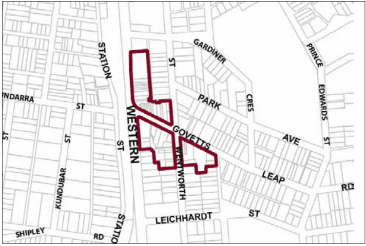

### G1.1 Blackheath Precinct E1-BH01—Town Centre

### Precinct

This precinct remains a compact town centre, accommodating a diverse range of small retailers, local businesses, tourist-related activities and permanent residents. Modestly-scaled buildings are arranged in a traditional main street pattern, creating continuous facades of one and two-storey buildings that reflect the traditional shopfront architecture of the Victorian, Federation and Inter-War periods.  As a whole, the group display an interesting variety of form and design. The form and architectural detail of landmark corner buildings, hotels and the former Victory Theatre are preserved. Future development is to be sympathetic and subservient to the distinctive character of these landmarks and this urban pattern, and promote new retail frontages facing existing carparks and laneways. Active street frontages are encouraged, with pedestrian activity concentrated along the streets, laneways and around the carparks, encouraging informal community gatherings in areas that are protected from undesirable impacts of through traffic. Reference should be made to the precinct objectives in clause 7.2(1) of LEP 2015.

> [Picture on page 6: a picture, saved as a picture (images/part-g-locality-management-page-6-19.gif, 150 dpi).]

Part G1: Blackheath

Blackheath Precinct E1-BH01—Town Centre Precinct

#### Controls

C1. Development is to satisfy LEP 2015 clause 7.1 (development in villages) and be consistent with the precinct objectives of clause 7.2(1) of LEP 2015.

C2. The height of a building is not to exceed the maximum height of building set by clause 4.3 of LEP 2015  and the accompanying Height of Buildings Map.

C3. The floor space ratio of a development is not to exceed the maximum floor space ratio set by clause 4.4 of LEP 2015  and the accompanying Floor Space Ratio Map.

C4. Front and side setbacks are to be zero, except in the case of side setbacks if it can be satisfactorily demonstrated that a side boundary adjoins the public domain and that an active street frontage will be provided.

C5. The maximum site cover for buildings is 80% of the total allotment area.

C6. The existing continuity of retail and other businesses facing the Highway, Govetts Leap Road and Wentworth Street is to be retained.

Part G1: Blackheath

C7. On properties with secondary frontages to the public domain, the secondary frontage is to provide new retail or other commercial activity to at least 50% of ground level frontages to the public domain, and for all storeys above ground, balconies or extensive windows, or both, facing the public domain is to be provided.

C8. On properties facing Hydora Lane, the laneway can be activated by commercial use. Development is to be subservient to the traditional rear wing forms and layouts of the shopfront buildings, and is to maintain the use of traditional rear elevation materials such as commons bricks, timber joinery and corrugated metal sheeting. Views of the upper level rear elevations of properties fronting Govetts Leap Road and the Highway are to be maintained.

C9. The pattern of traditional main street Victorian, Federation and  Inter- War shop-terraces facing principal street frontages is to be retained and enhanced.

C10. Existing or original shopfront buildings are to be retained and conserved, including the street façade, principal rooms and all associated original elements and details.

Note: Refer to D9.7 Traditional shopfront buildings in Part D Heritage where heritage considerations apply. Alterations and additions to shop buildings and infill development are to be in accordance with traditional shopfront building design, and to ensure that where appropriate, continuous awnings and/or balconies are provided.

Note: Guidelines on traditional shopfront design are found in B3.1.3 Infill shopfront buildings in B3 Character and design, and in D1.9.7 Traditional shopfront buildings in Part D Heritage  where heritage considerations apply.

C11. Development on large allotments is to distribute floorspace into carefully-articulated structures that are composed of separate wings, pavilions or interconnected buildings, with traditionally-pitched roofs and appropriately landscaped garden courtyards with canopy trees.

C12. On-site parking areas are to be accessed only from the rear or side of buildings via existing public carparks, laneways or secondary streets, and are to be concealed behind retail or business floorspace wherever possible.

C13. The existing pedestrian network is to be expanded by promoting new retail frontages surrounding the public domain.

Part G1: Blackheath

C14. Solar access to the public domain is to be protected and enhanced.

C15. Continuous weather protection along all public frontages in the form of awnings or overhanging balconies is to be provided.

C16. Ground floor walls and structures are to protect and enhance sight lines in the public domain.
