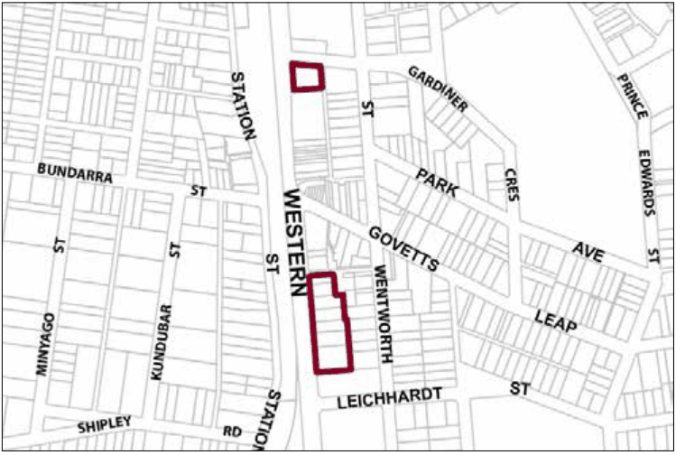

### G1.2 Blackheath Precinct E1-BH02—Business Cottages

### Precinct

A variety of businesses, retailers, tourist-related activities and dwellings are accommodated in predominantly traditional Federation weatherboard cottages surrounded by established garden settings. Existing cottages are conserved and sympathetically enhanced to maintain the historical value of this prominent location and to provide a visually distinctive backdrop to the neighbouring main street. Reference should be made to the precinct objectives in clause 7.2(2) of LEP 2015.

> [Picture on page 9: a picture, saved as a picture (images/part-g-locality-management-page-9-10.gif, 150 dpi).]

Part G1: Blackheath

Blackheath Precinct E1-BH02—Business Cottages Precinct

#### Controls

C1. Development is to satisfy LEP 2015 clause 7.1 (Development in villages) and be consistent with the precinct objectives of clause 7.2(2) of LEP 2015.

C2. The height of a building is not to exceed the maximum height of building set by clause 4.3 of LEP 2015  and the accompanying Height of Buildings Map.

C3. The floor space ratio of a development is not to exceed the maximum floor space ratio set by clause 4.4 of LEP 2015  and the accompanying Floor Space Ratio Map.

C4. The height above ground for the lowest habitable floor level is not to exceed 1m.

C5. Cut or fill within 5m of any property boundary is not to exceed 0.5m.

C6. Development is to provide front setbacks consistent with that of adjacent buildings.

C7. Development is to provide a minimum side boundary setback of 2m.

C8. Development is to provide a minimum rear boundary setback of 6m.

C9. All setback areas are to be landscaped.

C10. The maximum site cover for buildings is 50% of the total allotment area.

C11. The minimum area to be retained as soft, pervious or landscaped area (excluding hard surfaces) is 40% of the total allotment area.

Part G1: Blackheath

C12. New development is to be sympathetic to the traditional building forms, materials and details of the precinct, including the use of traditionally-pitched roofs, articulated layouts and forms, verandahs, timber joinery, vertically–proportioned openings and some painted external finishes, with a curtilage of landscaped areas and an address to the street provided. New development is to be similar in form and materials to quality older buildings but subservient in detail to distinguish it as new work.

C13. Any non-residential activities are to be accommodated in buildings with a residential scale and character.

C14. Buildings are not to exceed 18m width or depth in any direction.

C15. Gardens are to provide and maintain a backdrop of canopy trees along rear boundaries, plus trees and shrubs scattered through front and side yards.

C16. Driveways, parking areas and garages are to be integrated with the design of surrounding landscaped areas, with garages and parking to be behind the front building setback.
