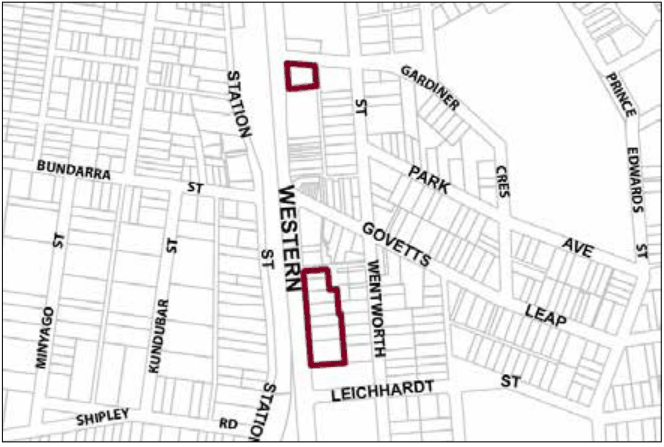

### G1.3 Blackheath Precinct E1-BH03—Highway Business

### Precinct

A variety of medium-scale retail and other businesses and tourist-related activities are accommodated in a location that is both visually prominent and highly accessible, serving both the resident community and visitors. New development is to promote a scenically-distinctive highway frontage to the Blackheath village, with landscaped settings that incorporate backdrops of tall canopy trees and distinctively-landscaped front gardens, plus building forms that reflect features of traditional main street shops or landmark guesthouses. Reference should be made to the precinct objectives in clause 7.2(3) of LEP 2015.

> [Picture on page 11: a picture, saved as a picture (images/part-g-locality-management-page-11-11.gif, 150 dpi).]

Part G1: Blackheath

Blackheath Precinct E1-BH03—Highway Business Precinct

#### Controls

C1. Development is to satisfy LEP 2015 clause 7.1 (Development in villages) and be consistent with the precinct objectives of clause 7.2(3) of LEP 2015.

C2. The height of a building is not to exceed the maximum height of building set by clause 4.3 of LEP 2015  and the accompanying Height of Buildings Map.

C3. The floor space ratio of a development is not to exceed the maximum floor space ratio set by clause 4.4 of LEP 2015  and the accompanying Floor Space Ratio Map.

C4. The height above ground for the lowest habitable floor level is not to exceed 1m.

C5. Cut or fill within 5m of any property boundary is not to exceed 0.5m.

Part G1: Blackheath

| C6. | Development is to provide a minimum setback to the Great Western Highway of 6m. |
|---|---|
| C7. | Development is to provide a minimum side boundary setback of 2m. |
| C8. | For development that shares a rear boundary with existing residential development, the development is to provide a minimum rear boundary setback of 6m. |
| C9. | All setback areas are to be landscaped. |
| C10. | The maximum site cover for buildings is 55% of the total allotment area. |
| C11. | The minimum area to be retained as soft, pervious or landscaped area (excluding hard surfaces) is 35% of the total allotment area. |
| C12. | Development facing the Highway is to promote new retail or other commercial activity along at least 50% of ground level frontages, and for all storeys above ground, incorporate balconies and/or extensive windows. |
| C13. | New development is to be sympathetic to the traditional building forms, materials and details of the precinct, and incorporate traditionally- pitched roofs and/or parapets, traditional shopfront design, articulated building forms and layouts, vertically-proportioned openings, and sympathetic materials and detailing as appropriate to the context. New development is to be similar in form and materials to quality older buildings but subservient in detail to distinguish it as new work. Note: Guidelines on traditional shopfront design are found in B3.1.3 Infill shopfront buildings in B3 Character and design, and in D9.7 Traditional shopfront buildings in Part D Heritage where heritage considerations apply. |
| C14. | Gardens are to provide a backdrop of canopy trees along rear boundaries, plus scattered trees and shrubs through front and side yards to frame buildings, driveways and parking areas. |
| C15. | On-site parking areas are to be located behind buildings and concealed from the Highway where possible, and are to be integrated with landscape design of garden areas. |
| C16. | New retail frontages are to be provided along the Highway to expand the existing town centre pedestrian network. |
