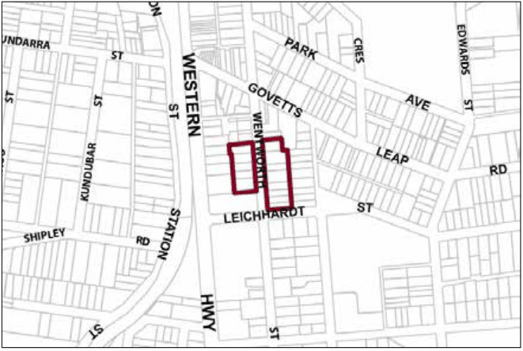

### G1.4 Blackheath Precinct R3-BH04—Wentworth Street

### Precinct

A mix of single and multiple-unit dwellings are located close to the town centre, expanding the range of residential accommodation that is available in the Blackheath village. In order to provide a visually distinctive backdrop to the neighbouring town centre, redevelopments are encouraged to restore existing cottages and retain visually significant elements of established garden settings. New buildings will reflect the pattern, scale, forms and detailing of traditional cottage forms. Reference should be made to the precinct objectives in clause 7.2(4) of LEP 2015.

> [Picture on page 13: a picture, saved as a picture (images/part-g-locality-management-page-13-11.gif, 150 dpi).]

Part G1: Blackheath

Blackheath Precinct R3-BH04—Wentworth Street Precinct

#### Controls

C1. Development is to satisfy LEP 2015 clause 7.1 (Development in villages) and be consistent with the precinct objectives of clause 7.2(4) of LEP 2015.

C2. The height of a building is not to exceed the maximum height of building set by clause 4.3 of LEP 2015  and the accompanying Height of Buildings Map.

C3. The floor space ratio of a development is not to exceed the maximum floor space ratio set by clause 4.4 of LEP 2015  and the accompanying Floor Space Ratio Map.

C4. The height above ground for the lowest habitable floor level is not to exceed 1m.

C5. Cut or fill within 5m of any property boundary is not to exceed 0.5m.

Part G1: Blackheath

| C6. | The setback to Wentworth Street is to be a minimum of 8m. |
|---|---|
| C7. | On corner allotments, the setback to the secondary frontage is to be a minimum of 4m. |
| C8. | Side boundary setbacks are to be a minimum of 2m. |
| C9. | Development located on the western side of Wentworth Street is to provide a minimum rear setback of 2m. |
| C10. | Development located on the eastern side of Wentworth Street is to provide a minimum rear setback of 6m. |
| C11. | All setback areas are to be landscaped. |
| C12. | The maximum site cover for buildings is 50% of the total allotment area. |
| C13. | The minimum area to be retained as soft, pervious or landscaped area (excluding hard surfaces) is 40% of the total allotment area. |
| C14. | New development is to be sympathetic to the traditional building forms, materials and details of the precinct, including the use of traditionally- pitched roofs, articulated layouts and forms, verandahs, timber joinery, vertically–proportioned openings and some painted external finishes, with a curtilage of landscaped areas and an address to the street provided. New development is to be similar in form and materials to quality older buildings but subservient in detail to distinguish it as new work. |
| C15. | Buildings are not to exceed 15m width or depth in any direction. |
| C16. | Any non-residential activities are to be accommodated in buildings with a residential scale and character. |
| C17. | Gardens are to incorporate a backdrop of canopy trees along rear boundaries, plus trees and shrubs scattered through front and side yards. |
| C18. | Driveways, parking areas and garages are to be integrated with the design of surrounding landscaped areas, with garages and parking to be behind the front building setback. |
