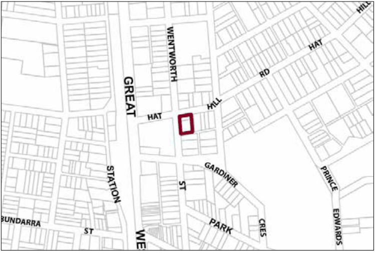

### G1.5 Blackheath Precinct R3-BH05—Cnr Hat Hill Road

### and Wentworth Street Precinct

Alternative forms of housing are provided within a landscaped setting that is in sympathy with the park opposite. The housing contributes to meeting housing demand in accordance with changing demographics within the Blue Mountains. Reference should be made to the precinct objectives in clause 7.2(5) of LEP 2015.

> [Picture on page 15: a picture, saved as a picture (images/part-g-locality-management-page-15-7.gif, 150 dpi).]

Part G1: Blackheath

Blackheath Precinct R3-BH05—Cnr Hat Hill Road and Wentworth Street Precinct

#### Controls

C1. Development is to satisfy LEP 2015 clause 7.1 (Development in villages) and be consistent with the precinct objectives of clause 7.2(5) of LEP 2015.

C2. The height of a building is not to exceed the maximum height of building set by clause 4.3 of LEP 2015  and the accompanying Height of Buildings Map.

C3. The floor space ratio of a development is not to exceed the maximum floor space ratio set by clause 4.4 of LEP 2015  and the accompanying Floor Space Ratio Map.

C4. The minimum setback from the street frontage is 4.5m.

C5. The maximum site coverage for each allotment is 50%.

C6. The minimum pervious area required for each allotment is 40%.

C7. Development is to provide articulation and building modulation in order to minimise the bulk of buildings.

C8. Development is to provide an activated street frontage to the primary street.

C9. Development is to provide landscaping along the street frontages that is reflective of plantings along Wentworth Street.

C10. Garages, access and car parking are to be screened from the public domain with garages and parking areas located internally so as not to adversely impact upon streetscape, pedestrian circulation, and building character.

Part G1: Blackheath
