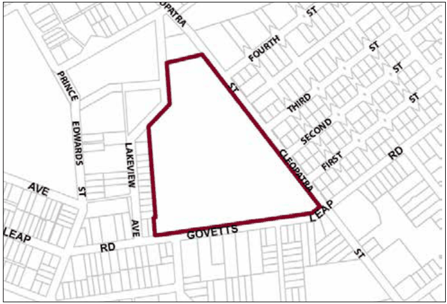
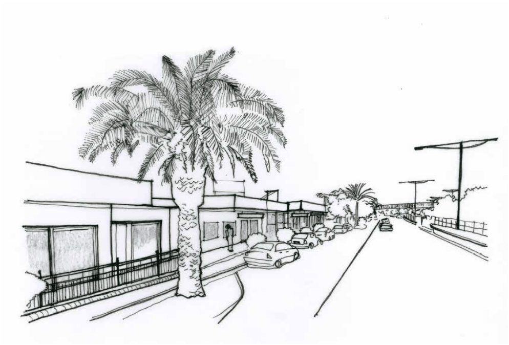

### G1.6 Blackheath Precinct R1-BH06— Govetts Leap

### Road Precinct

This site has a long history of providing tourist and visitor accommodation set within a well-established heritage listed garden. In addition to the complex of ‘high-end’ cottages, the facilities on the site are able to cater for special occasions such as weddings and conferences. The site is located within a reasonable walking distance of the Blackheath town centre and 1.2 km from Blue Mountains National Park and is adjoined by residential development on the fringes of the town centre. Any future development must take into consideration the importance of the location in relation to heritage value and environmental sensitive character of the adjoining Nature Reserves to the north. Consideration of bulk and scale, settings, views, architectural treatments and commercial signage are paramount. Reference should be made to the precinct objectives in clause 7.2(6) of LEP 2015.

> [Picture on page 17: a picture, saved as a picture (images/part-g-locality-management-page-17-15.gif, 150 dpi).]

Part G1: Blackheath

Blackheath Precinct R1-BH06—Govetts Leap Road Precinct

#### Controls

C1. Development is to satisfy LEP 2015 clause 7.1 (Development in villages) and be consistent with the precinct objectives of clause 7.2(6) of LEP 2015.

C2. The height of a building is not to exceed the maximum height of building set by clause 4.3 of LEP 2015 and the accompanying Height of Buildings Map.

C3. The floor space ratio of a development is not to exceed the maximum floor space ratio set by clause 4.4 of LEP 2015 and the accompanying Floor Space Ratio Map.

C4. The minimum setback from side boundaries is 15m. Setbacks are to be landscaped with trees, shrubs and groundcovers to ensure that development on the site is appropriately screened from outside the site.

C5. The minimum setback from Govetts Leap Road is 20m. Setbacks are to be landscaped with trees, shrubs and groundcovers to ensure that development on the site is appropriately screened from Govetts Leap Road

C6. The minimum setback from northern boundary is 40m. Within this 40m setback a 15m wide vegetated buffer, using locally indigenous vegetation, adjacent to Popes Glen Reserve, is to be installed and maintained.

C7. All buildings on the site are to be designed to ensure character, scale, architectural details and finished materials are complementary in theme to the existing buildings on the site.

Part G1: Blackheath

C8. All buildings on the site are to be distributed throughout the site so as to minimise the impact when viewed from any given point, either internally or externally.

C9. Conserve and actively manage all existing tree stands and shrubs. Development shall only be permitted in existing cleared areas.

C10. Successional planting and landscape management is to retain and enhance the existing landscape character of the site.

C11. Vehicular access to the site is limited to one vehicle access point to Govetts Leap Road and one vehicle access point to Cleopatra Street.

C12. Garages, access and car parking are to be integrated with landscaped areas such that they are well screened from the public domain, with garages and parking areas located so as to not adversely impact upon streetscape, pedestrian circulation, building character and adjoining residential amenity.

Note: Additional landscape controls specific to the R1 zone apply, refer to Part C3.8

### BLAXLAND

| G2.1 | Blaxland Precinct E2-BX01—Town Centre Precinct | 642 |
|---|---|---|
| G2.2 | Blaxland Precinct R3-BX02—Layton Avenue Precinct | 645 |
| G2.3 | Blaxland Precinct R3-BX03—Hope Street Precinct (106 Great Western Highway, Blax- land) 646 |  |
| G2.4 | Blaxland Precinct R3-BX04—Village Housing Precinct | 648 |
| G2.5 | Blaxland Precinct E1-BX05—Brooklands Village | 650 |
| G2.6 | Blaxland Precinct E1-BX06—East Blaxland Shops | 652 |
| G2.7 | Blaxland Precinct E4-BX07—22-26 Attunga Road | 654 |

> [Picture on page 19: a picture, saved as a picture (images/part-g-locality-management-page-19-3.gif, 150 dpi).]
