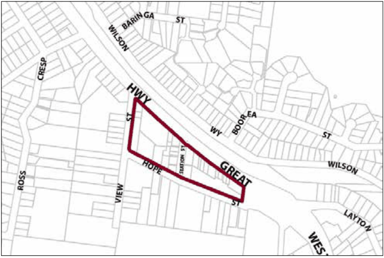

### G2.1 Blaxland Precinct E2-BX01—Town Centre Precinct

This precinct remains a compact town centre, accommodating a diverse range of small-to-medium scale retail and other businesses and permanent residents. Modern buildings are arranged in a traditional main street pattern, with a continuous row of one and two-storey shop-fronts surrounding a substantial open car park to the rear. Pedestrian movement is concentrated outdoors, encouraging informal community meeting places. The central car park is surrounded by eucalypts, including a distinctive large copse at the corner of View and Hope Streets, providing both a green backdrop to the town centre and a barrier to surrounding residential areas. Future development promotes an improved scenic presentation for this town centre, with buildings displaying some diversity of form and design, and maintaining glimpses of the National Park from the highway pedestrian bridge. The design of buildings and signage is coordinated, and there is visible indoor activity facing all public places including streets, laneways and car parks. Reference should be made to the precinct objectives in clause 7.3(1) of LEP 2015.

> [Picture on page 20: a picture, saved as a picture (images/part-g-locality-management-page-20-17.gif, 150 dpi).]

Part G2: Blaxland

Blaxland Precinct E2-BX01—Town Centre Precinct

#### Controls

C1. Development is to satisfy LEP 2015 clause 7.1 (Development in villages) and be consistent with the precinct objectives of clause 7.3(1) of LEP 2015.

C2. The height of a building is not to exceed the maximum height of building set by clause 4.3 of LEP 2015  and the accompanying Height of Buildings Map.

C3. The floor space ratio of a development is not to exceed the maximum floor space ratio set by clause 4.4 of LEP 2015  and the accompanying Floor Space Ratio Map.

C4. Development is to have a zero front setback, except in Hope Street where the setback is to be a minimum of 6m and is to be landscaped.

C5. Development is to have a zero side setback, except where the side boundary adjoins the public domain. In this case setbacks greater than zero may be considered where an active frontage will be provided.

C6. Notwithstanding C4 and C5, front and side setbacks at the intersection of Hope and View Streets are to be increased to protect the visually significant eucalypt canopy.

C7. The maximum site cover for buildings is 100% of the total allotment area, except for buildings on an allotment fronting Hope Street, where the maximum site cover is 80% of the total allotment area.

C8. Notwithstanding C7 at the corner of Hope and View Streets the footprint shall be reduced as necessary to conserve the visually significant eucalypt canopy.

Part G2: Blaxland

C9. The existing continuity of retail and other business premises on properties that face the Highway is to be maintained.

C10. On properties with a secondary frontage to a public place, new retail or other business premises are to be promoted along at least 50% of ground level frontages to public carparks, side streets and laneways, and for all storeys above ground, balconies and/or extensive windows facing those public places are to be included.

C11. On properties fronting Hope Street, extensive balconies and/or windows are to be promoted in all facades facing that street.

C12. New development is to have regard to the scale, forms and detailing of traditional shopfront buildings and to ensure that where appropriate, continuous awnings and/or balconies are provided.

Note: Guidelines on traditional shopfront design are found in B3.1.3 Infill shopfront buildings in B3 Character and design.

C13. Buildings are to present a high standard of architectural form and detailing, and formally address significant public domain areas within the immediate setting; service function areas are to be compact and discreetly located.

C14. Development on large allotments is to distribute floorspace into well-articulated structures that are composed of separate wings or interconnected buildings, with traditionally pitched roofs and appropriately-landscaped garden courtyards.

C15. Existing canopy trees are to be retained to frame building presentation. New landscaping is to be appropriately-sized and characteristic of the locality.

C16. On-site parking areas are to be accessed only from the rear or side of buildings via existing public car parks, laneways or secondary streets, and are to be concealed from principal frontages behind retail or other business premises.

C17. The existing pedestrian network is to be expanded by promoting new retail frontages surrounding the public places.

C18. Solar access to the public domain is to be protected and enhanced.

C19. Continuous weather protection is to be provided along all public frontages in the form of awnings or overhanging balconies.

C20. Ground floor walls and structures are to protect and enhance sight lines in public places.

Part G2: Blaxland
