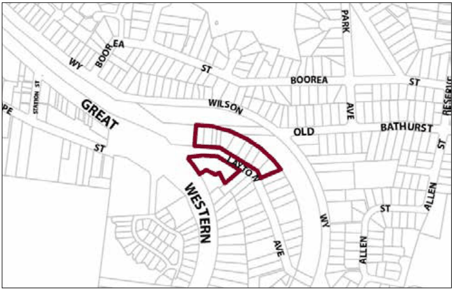

### G2.2 Blaxland Precinct R3-BX02—Layton Avenue

### Precinct

This precinct provides sensitive redevelopment for the purpose of alternate housing forms, designed so as to present a positive residential amenity in close proximity to services and public transport. New development contributes to the streetscape by providing active street frontages to Layton Avenue. Reference should be made to the precinct objectives in clause 7.3(2) of LEP 2015.

> [Picture on page 23: a picture, saved as a picture (images/part-g-locality-management-page-23-8.gif, 150 dpi).]

Part G2: Blaxland

Blaxland Precinct R3-BX02—Layton Avenue Precinct

#### Controls

C1. Development is to satisfy LEP 2015 clause 7.1 (Development in villages) and be consistent with the precinct objectives of clause 7.3(2) of LEP 2015.

C2. The height of a building is not to exceed the maximum height of building set by clause 4.3 of LEP 2015  and the accompanying Height of Buildings Map.

C3. The floor space ratio of a development is not to exceed the maximum floor space ratio set by clause 4.4 of LEP 2015  and the accompanying Floor Space Ratio Map.

C4. The minimum setback from Layton Avenue is 5m.

C5. Building form is to provide an active street frontage to Layton Avenue and facades fronting Layton Avenue are to be articulated through, for example, the provision of verandahs, windows and front doors.

C6. Development is to provide private open space in the form of landscaping with screening at the rear of the site.
