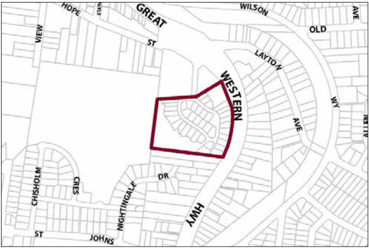

### G2.3 Blaxland Precinct R3-BX03—Hope Street Precinct

### (106 Great Western Highway, Blaxland)

This precinct promotes sensitive development for the purpose of promoting alternate housing forms, designed so as to present a positive residential amenity in close proximity to services and public transport. Development of this site maintains the bushland character of the locality and limits access onto the Great Western Highway. Reference should be made to the precinct objectives in clause 7.3(3) of LEP 2015.

> [Picture on page 24: a picture, saved as a picture (images/part-g-locality-management-page-24-9.gif, 150 dpi).]

Part G2: Blaxland

Blaxland Precinct R3-BX03—Hope Street Precinct (106 Great Western Highway, Blaxland)

#### Controls

C1. Development is to satisfy LEP 2015 clause 7.1 (Development in villages) and be consistent with the precinct objectives of clause 7.3(3) of LEP 2015.

C2. The height of a building is not to exceed the maximum height of building set by clause 4.3 of LEP 2015  and the accompanying Height of Buildings Map.

C3. The floor space ratio of a development is not to exceed the maximum floor space ratio set by clause 4.4 of LEP 2015  and the accompanying Floor Space Ratio Map.

C4. The minimum setback from the Great Western Highway is 14m.

C5. The maximum number of integrated dwellings permitted is 43.

C6. Building form is to provide for active street frontages to the internal streets in the development and facades fronting these streets shall be articulated through, for example, the provision of verandahs, windows or front doors.

C7. The development is to provide screening in the form of landscaping along the Great Western Highway frontage of the site in order to provide private open space and provide visual and acoustic amenity for residents.

C8. The development is to incorporate appropriate mitigation measures such as stormwater treatment and bushland regeneration to ensure the protection of habitat for threatened species such as the Red-crowned Toadlet.

C9. Communal open space is to be provided so as to provide recreational opportunities for the residents of the development, allow for stormwater management on site, and promote bushland regeneration to ensure the protection of habitat for threatened species, such as the Red-crowned Toadlet.

Part G2: Blaxland

C10. Vehicular access to land within the precinct is to be provided from the public road linking the northern boundary of the precinct to the Great Western Highway.
