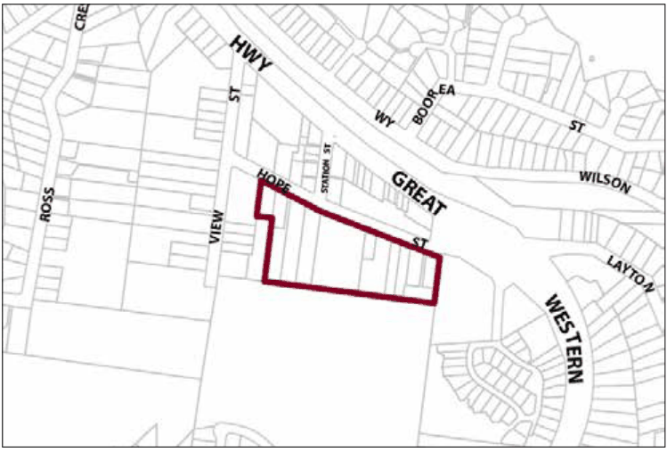

### G2.4 Blaxland Precinct R3-BX04—Village Housing

### Precinct

This precinct provides a mix of single and multiple-unit dwellings, plus a variety of low-key businesses facing Hope Street. Future development is planned and constructed to protect neighbouring bushland from adverse visual or environmental impacts, as well as to provide an attractive backdrop to the town centre, and to expand the range of residential accommodation and community services available in the Blaxland Village. New development will reflect the scale, forms, materials and details of existing traditional cottages, and provide garden settings that support a dense bushland backdrop. Buildings and site works are set close to Hope Street, protecting steeper wooded slopes from disturbance and maintaining substantial landscape buffers of canopy trees and understorey along the rear boundary. Street frontages are landscaped to provide a visually distinctive backdrop to the town centre. Reference should be made to the precinct objectives in clause 7.3(4) of LEP 2015.

> [Picture on page 26: a picture, saved as a picture (images/part-g-locality-management-page-26-17.gif, 150 dpi).]

Part G2: Blaxland

Blaxland Precinct R3-BX04—Village Housing Precinct

#### Controls

C1. Development is to satisfy LEP 2015 clause 7.1 (Development in villages) and be consistent with the precinct objectives of clause 7.3(4) of LEP 2015.

C2. The height of a building is not to exceed the maximum height of building set by clause 4.3 of LEP 2015  and the accompanying Height of Buildings Map.

C3. The floor space ratio of a development is not to exceed the maximum floor space ratio set by clause 4.4 of LEP 2015  and the accompanying Floor Space Ratio Map.

C4. The height above ground for the lowest habitable floor level is not to exceed 1.5m.

C5. Cut or fill within 5m of any property boundary is not to exceed 0.5m.

C6. The minimum setback from the street frontage is 8m.

C7. Side boundary setbacks are to be a minimum of 2m.

C8. All setback areas are to be landscaped.

C9. The maximum site cover for buildings is 40% of the total allotment area.

C10. The minimum area to be retained as soft, pervious or landscaped area (excluding hard surfaces) is 50% of the total allotment area.

C11. Development is to be sited, designed and constructed to minimise impacts upon surrounding bushland.

Part G2: Blaxland

C12. Landscaping is to minimise impacts on neighbouring bushland communities whilst minimising bushfire hazard. New landscape plantings are to be either endemic to the locality or be of low to nil invasive potential.

C13. New development is to be sympathetic to traditional building forms, materials and details, including the use of traditionally-pitched roofs, articulated layouts and forms, verandahs, timber joinery, vertically– proportioned openings and some painted external finishes, with a curtilage of landscaped areas and an address to the street provided. New development is to be similar in form and materials to quality older buildings but subservient in detail to distinguish it as new work.

C14. Buildings are not to exceed 15m width or depth in any direction.

C15. Any non-residential activities along Hope Street are to be accommodated in buildings with a residential scale and character.

C16. Driveways, parking areas and garages are not to dominate any street frontage, and are to be integrated with the design of surrounding landscaped areas.
