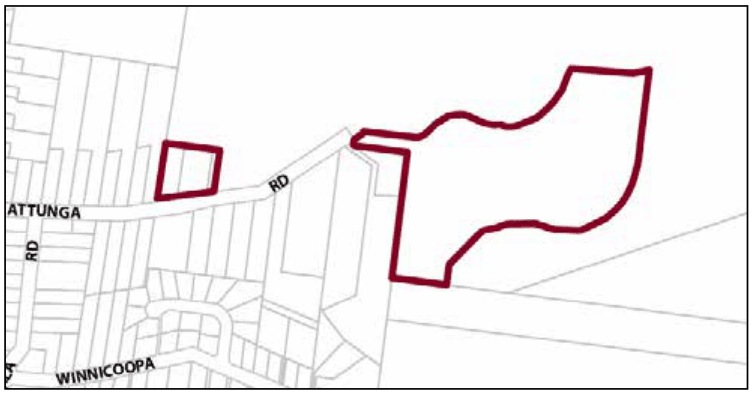

### G2.7 Blaxland Precinct E4-BX07—22-26 Attunga Road

This precinct provides facilities and services that meet the day to day needs of workers in and around the area, as well as supports the local economy. The precinct is surrounded by established low density residential areas and bushland communities. Therefore, it is necessary to facilitate compatible employment uses, with new development incorporating measures to mitigate operational impacts upon adjoining or adjacent residential land uses. Future development is designed and landscaped in accordance with its bushland setting, to create a transition between employment precincts and low density residential areas, while low density residential development in established residential areas does not compromise existing employment uses. Reference should be made to the precinct objectives in clause 7.3(6) of LEP 2015.

> [Picture on page 32: a picture, saved as a picture (images/part-g-locality-management-page-32-13.gif, 150 dpi).]

Part G2: Blaxland

Blaxland Precinct E4-BX07—Attunga Road

#### Controls

C1. Development is to satisfy LEP 2015 clause 7.1 (development in villages) and be consistent with the precinct objectives of clause 7.3(6) of LEP 2015.

C2. The height of a building is not to exceed the maximum height of building set by clause 4.3 of LEP 2015 and the accompanying Height of Buildings Map.

C3. The floor space ratio of a development is not to exceed the maximum floor space ratio set by clause 4.4 of LEP 2015 and the accompanying Floor Space Ratio Map.

C4. Setbacks are to be a minimum 4m and a maximum of 8m from the front boundary and side and rear setbacks are subject to a merit-based assessment.

C5. The minimum area to be retained as pervious area, is 30% of the total allotment area.

C6. Cut or fill within 5m of any property boundary is not to exceed 0.5m.

C7. Development is to be sited, designed and constructed to minimise impacts upon surrounding bushland.

C8. Landscaping is to minimise impacts on neighbouring bushland communities whilst minimising bushfire hazard. New landscape plantings are to be either endemic to the locality or be of low to nil invasive potential.

C9. All parking demands generated by developments are to be met fully on-site and accord with

C10. Existing priority weeds must be removed or controlled where identified on a proposed development site.

C11. Any fencing along the front boundary of the site and along any side boundary that is located within the front building setback applying to the land must be decorative. The sole use of pre-painted metal or standard paling fencing is not permitted.

Part G2: Blaxland

C12. An area for storing garbage and recycling shall be provided, suitably located and screened. Where a development adjoins residential development, the garbage storage area must be located at least 3 metres from the common boundary of the residential property and the development site.

C13. Any parking and heavy vehicle loading and manoeuvring areas are to be designed to minimise visual impact when viewed from the public domain, and to be safely and efficiently designed.

Part G2: Blaxland

### FAULCONBRIDGE

| G3.1 | Faulconbridge Precinct E1-FB01—Coomassie Shops Faulconbridge | 658 |
|---|---|---|
| G3.2 | Faulconbridge Precinct E1-FB02—St Georges Crescent Shops Faulconbridge | 661 |
