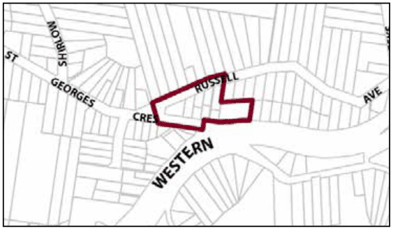
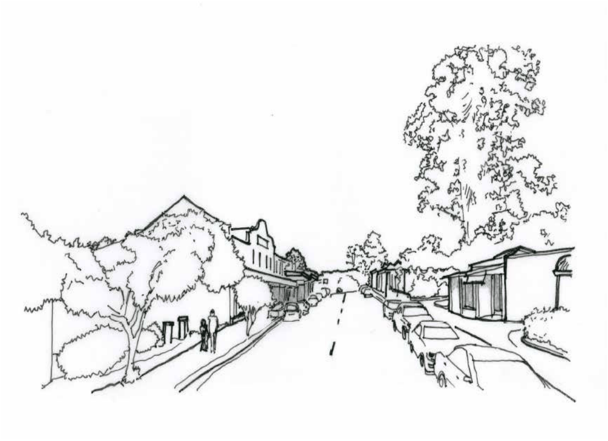

### G3.2 Faulconbridge Precinct E1-FB02—St Georges

### Crescent Shops Faulconbridge

This precinct is a compact local centre, accommodating a diverse range of small scale retail and other commercial businesses that serve the local community as well as visitors. Future development promotes the creation of a distinct village identity and provides the coordinated design of business signage and shop fronts in accordance with a village theme. Non-residential uses are compatible with residential uses and do not unreasonably affect amenity. Reference should be made to the precinct objectives in clause 7.3A of LEP 2015..

> [Picture on page 39: a picture, saved as a picture (images/part-g-locality-management-page-39-11.gif, 150 dpi).]

Part G4: Glenbrook

Part G3: Faulconbridge

Faulconbridge Precinct E1-FB02—St Georges Crescent Shops Faulconbridge

#### Controls

C1. Development is to satisfy LEP 2015 clause 7.1 (development in villages) and be consistent with the precinct objectives of clause 7.3A of LEP 2015.

C2. The height of a building is not to exceed the maximum height of building set by clause 4.3 of LEP 2015 and the accompanying Height of Buildings Map.

C3. The floor space ratio of a development is not to exceed the maximum floor space ratio set by clause 4.4 of LEP 2015 and the accompanying Floor Space Ratio Map.

C4. Development adjoining the public domain is generally to provide a zero setback, except where it can be demonstrated that an active frontage will be provided.  All side and rear setbacks will be subject to a merit based assessment having regard to the character of the area and amenity of the neighbouring properties.

C5. The height above ground for the lowest habitable floor level is not to exceed 1m.

C6. Cut or fill within 5m of any property boundary is not to exceed 0.5m.

C7. All setback areas are to be landscaped.

C8. The maximum site cover for buildings is 70% of the total allotment area, except for buildings on land adjoining an existing residential allotment where the site is limited to 50% of the total allotment area.

C9. The minimum area to be retained as soft, pervious or landscaped area (excluding hard surfaces) is 25% of the total allotment area.

C10. Ground floor walls and structures are to protect and enhance sight lines in the public domain.

C11. Walls are not to be left blank or unarticulated.

C12. Local design themes are to predominate over corporate signage and reflect the village character.

C13. Signage is to be coordinated with shop front design.

C14. On-site car parking is to be concealed behind commercial premises, or screened by landscaping or an architectural treatment that is consistent with the building adjoining the point of access.

Part G4: Glenbrook

Part G3: Faulconbridge

C15. On any allotment adjoining an existing residential property, facades are to locate balconies or windows, or both, in a way that is designed to protect residential amenity.

C16. Any parking and heavy vehicle loading and manoeuvring areas are to be designed to minimise visual impact when viewed from the public domain, and to be safely and efficiently designed.

C17. For allotments on the northern side of the highway, each secondary frontage to a public road, lane way or public place is to provide a visible and active street frontage distributed along a minimum of 65% of that frontage.

C18. Street corners are to be reinforced through design elements such as splay walls and orientation of entry and window elements.

C19. Development is to respond to the topography of the site and step down the slope.

C20. All existing vegetation forming visually significant streetscape elements is to be retained and appropriate landscaping shall be provided within any setbacks.

### GLENBROOK

G4.1 Glenbrook Precinct E1-GB01—Glenbrook Shops Precinct

664

> [Picture on page 41: a picture, saved as a picture (images/part-g-locality-management-page-41-4.gif, 150 dpi).]
