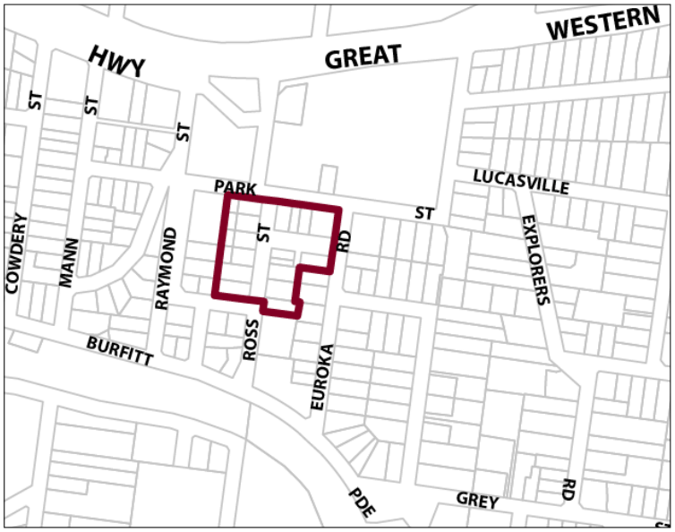
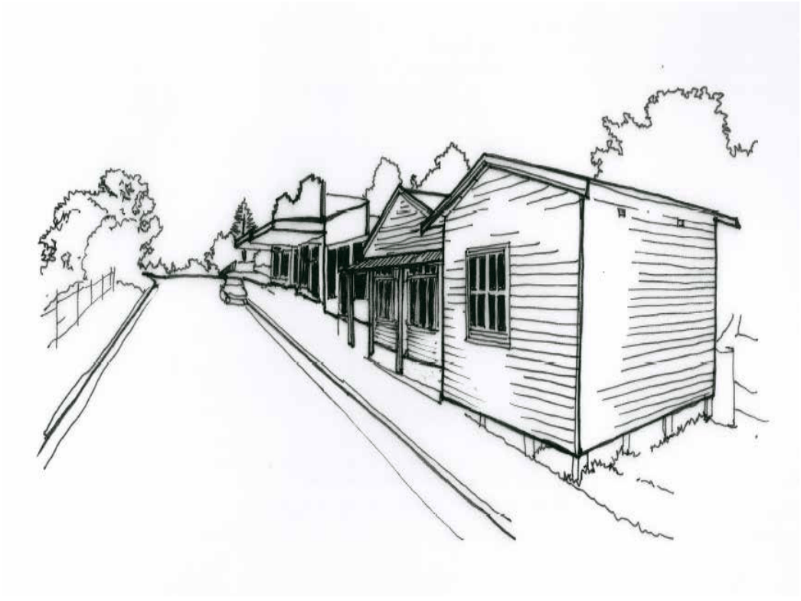

### G4.1 Glenbrook Precinct E1-GB01—Glenbrook Shops

### Precinct

Situated beside Glenbrook Park and surrounded by residential neighbourhoods, the shopping precinct supports a variety of small retail and other commercial businesses that serve the local community as well as visitors. The setting is pedestrian-friendly and principal streets are lined by single-storey shop front buildings and converted cottages. Public car parking is concentrated along secondary streets behind the business premises. Reference should be made to the precinct objectives in clause 7.4 of LEP 2015.

> [Picture on page 42: a picture, saved as a picture (images/part-g-locality-management-page-42-10.gif, 150 dpi).]

Part G4: Glenbrook

Glenbrook Precinct E1-GB01—Glenbrook Shops Precinct

#### Controls

C1. Development is to satisfy LEP 2015 clause 7.1 (Development in villages) and be consistent with the precinct objectives of clause 7.4 of LEP 2015.

C2. For new development on properties with existing shop front buildings facing Park Street, Ross Street and Euroka Road, there is to be a zero front and side setback.

C3. For new development on properties that contain existing cottages, the existing front setback is to be maintained and side setbacks of 1m minimum are to be provided. The built frontage is not to exceed 75% of the lot width.

C4. Rear boundary setbacks adjoining a residential neighbourhood are to be a minimum of 6m and to retain any existing vegetation that forms a visually significant streetscape element.

C5. All existing vegetation forming visually significant streetscape elements is to be retained.

C6. Development fronting Park Street, Ross Street and Euroka Road is to incorporate visible retail or commercial activity along the entire length of that street frontage, and continuous overhead awnings over the entire length of that frontage.

C7. Development with a frontage to a lane is to incorporate visible retail or commercial activity along a minimum of 50% of any allotment frontage, and continuous overhead awnings over the entire length of that frontage.

C8. New development is to be sympathetic to the periods and architectural character of existing buildings in its forms and finishes.

C9. Walls are not to be left blank or unarticulated.

Part G4: Glenbrook

C10. For allotments with shop front buildings, development is to be of masonry walls, with simple skillion roofs behind parapets, and detailing sympathetic and subservient to the existing character of the precinct.

Note: Guidelines on traditional shopfront design are found in B3.1.3 Infill shopfront buildings in B3 Character and design, and in D9.7 Traditional shopfront buildings in Part D Heritage  where heritage considerations apply.

C11. For allotments with existing cottages, development is to continue traditional residential building forms that reflect the existing cottage, use light-weight cladding materials and articulate any facades visible from the public domain.

C12. Local design themes are to predominate over corporate signage and reflect the village character.

C13. Signage is to be coordinated with shop front design.

C14. On-site vehicular access is to be, where possible, from a lane and not via Park, Euroka or Ross Streets for a property with frontage to these streets.

C15. On-site car parking is to be concealed behind commercial premises, or screened by landscaping or an architectural treatment that is consistent with the building adjoining the point of access.

Part G4: Glenbrook

### HAZELBROOK

| G5.1 | Hazelbrook Precinct E1-HB01—Town Centre Precinct | 668 |
|---|---|---|
| G5.2 | Hazelbrook Precinct R3-HB02—Glendarrah Street Precinct | 671 |
| G5.3 | Hazelbrook Precinct R3-HB03—Addington Road Precinct | 673 |
| G5.4 | Hazelbrook Precinct E1-HB04 – Old Hazelbrook Shops Precinct | 675 |

> [Picture on page 45: a picture, saved as a picture (images/part-g-locality-management-page-45-3.gif, 150 dpi).]
