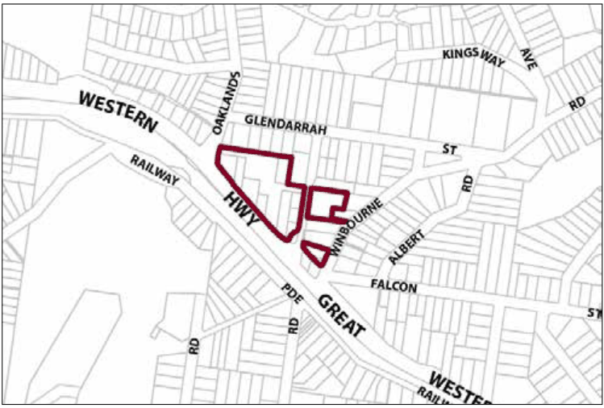

### G5.1 Hazelbrook Precinct E1-HB01—Town Centre

### Precinct

This precinct remains a compact town centre, accommodating a diverse range of small-to-medium scale retailers, other local businesses and permanent residents, surrounding a central car park landscaped with tall eucalypts that provide scenic backdrops to the centre as well as buffers to surrounding residential streets. Modern buildings display a co-ordinated design theme that reflects the traditional main street pattern of continuous one and two-storey shop front buildings. Development promotes improved standards of scenic presentation for this town centre, with buildings maintaining vistas towards the existing tree canopy and maintaining landscaped setbacks to neighbouring residential properties and residential streets. Indoor activities are visible along all public frontages, with pedestrian movement concentrated outdoors and promoting focal points for informal community gatherings that are protected from undesirable impacts of through traffic. Reference should be made to the precinct objectives in clause 7.5(1) of LEP 2015.

> [Picture on page 46: a picture, saved as a picture (images/part-g-locality-management-page-46-17.gif, 150 dpi).]

Part G5: Hazelbrook

Hazelbrook Precinct E1-HB01—Town Centre Precinct

#### Controls

C1. Development is to satisfy LEP 2015 clause 7.1 (Development in villages) and be consistent with the precinct objectives of clause 7.5(1) of LEP 2015.

C2. The height of a building is not to exceed the maximum height of building set by clause 4.3 of LEP 2015  and the accompanying Height of Buildings Map.

C3. The floor space ratio of a development is not to exceed the maximum floor space ratio set by clause 4.4 of LEP 2015  and the accompanying Floor Space Ratio Map.

C4. Development adjoining the public domain is generally to provide a zero setback, except where it can be demonstrated that an active frontage will be provided. The exception is at the Great Western Highway and Glendarrah Street where development is to provide a minimum setback of 6m.

C5. All setback areas are to be landscaped.

C6. The maximum site cover for buildings is 100% of the total allotment area, except for buildings on land adjoining an existing residential allotment where the site is limited to 70% of the total allotment area.

C7. The existing continuity of retail and other business premises on properties that face the public car park is to be maintained.

Part G5: Hazelbrook

C8. For allotments adjoining the public car park and facing the Great Western Highway, new buildings are to provide new retail or other business premises with shop fronts along at least 50% of ground level frontages, and balconies or extensive windows, or both, for aboveground storeys.

C9. On any allotment adjoining an existing residential property, facades are to locate balconies or windows, or both, in a way that is designed to protect residential amenity.

C10. New retail development facing principal streets is to be in accordance with the design of traditional shopfront buildings,  and to generally provide the following:

(a) narrow shopfronts, and

(b) continuous awnings and/or balconies, and

(c) references to traditional shopfront detailing in sympathetic contemporary materials and details.

Note: Guidelines on traditional shopfront design are found in B3.1.3 Infill shopfront buildings in B3 Character and design.

C11. Landscaped setbacks adjacent to residential properties or facing residential streets are to incorporate eucalypt species that are consistent with the established canopy.

C12. On-site parking areas are to be accessed only from the rear or side of buildings via existing public carparks, laneways or secondary streets, and are to be concealed from principal frontages behind retail or other business premises.

C13. The existing pedestrian network is to be expanded by promoting new retail frontages surrounding public places and fronting the Highway.

C14. Solar access to the public domain is to be protected and enhanced.

C15. Continuous weather protection along all public frontages in the form of awnings or overhanging balconies is to be provided.

C16. Ground floor walls and structures are to protect and enhance sight lines in public places.

Part G5: Hazelbrook
