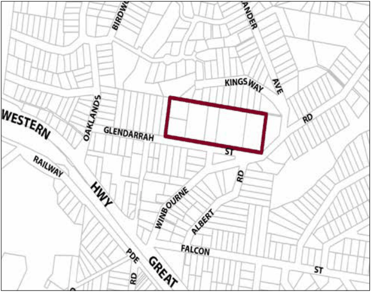

### G5.2 Hazelbrook Precinct R3-HB02—Glendarrah Street

### Precinct

This precinct provides alternative housing types within a landscape setting of substantial radiata pines. Reference should be made to the precinct objectives in clause 7.5(2) of LEP 2015.

> [Picture on page 49: a picture, saved as a picture (images/part-g-locality-management-page-49-6.gif, 150 dpi).]

Part G5: Hazelbrook

Hazelbrook Precinct R3-HB02—Glendarrah Street Precinct

#### Controls

C1. Development is to satisfy LEP 2015 clause 7.1 (Development in villages) and be consistent with the precinct objectives of clause 7.5(2) of LEP 2015.

C2. The height of a building is not to exceed the maximum height of building set by clause 4.3 of LEP 2015  and the accompanying Height of Buildings Map.

C3. The floor space ratio of a development is not to exceed the maximum floor space ratio set by clause 4.4 of LEP 2015  and the accompanying Floor Space Ratio Map.

C4. Building height and roof pitch are to be varied in order to minimise the bulk of buildings.

C5. The minimum setback of buildings from Glendarrah Street is 15m.

C6. Building form is to provide an activated and safe, pedestrian-friendly street frontage through the provision of windows, verandahs and doorways to Glendarrah Street.

C7. Car parking areas and hard surfaces are to be screened through the provision of dense planting.

C8. The existing mature pine trees are to be retained and enhanced with further planting in the building setback in order to substantially screen any development from Glendarrah Street.

Part G5: Hazelbrook
