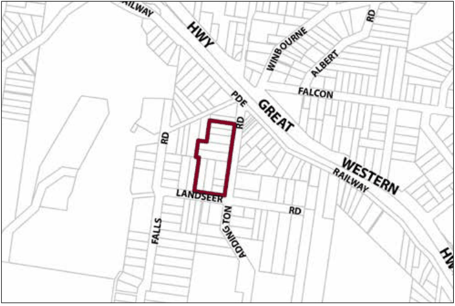

### G5.3 Hazelbrook Precinct R3-HB03—Addington Road

### Precinct

This precinct provides a mix of single and multiple-unit dwellings located close to the town centre and expands the range of residential accommodation available in the Hazelbrook village. Redevelopment is to restore existing traditional cottages, and retain visually significant elements of established garden settings. New buildings will reflect the pattern, scale and architectural style of traditional Federation and Inter-War cottages surrounded by gardens. Reference should be made to the precinct objectives in clause 7.5(3) of LEP 2015.

> [Picture on page 51: a picture, saved as a picture (images/part-g-locality-management-page-51-11.gif, 150 dpi).]

Part G5: Hazelbrook

Hazelbrook Precinct R3-HB03—Addington Road Precinct

#### Controls

C1. Development is to satisfy LEP 2015 clause 7.1 (Development in villages) and be consistent with the precinct objectives of clause 7.5(3) of LEP 2015.

C2. The height of a building is not to exceed the maximum height of building set by clause 4.3 of LEP 2015  and the accompanying Height of Buildings Map.

C3. The floor space ratio of a development is not to exceed the maximum floor space ratio set by clause 4.4 of LEP 2015  and the accompanying Floor Space Ratio Map.

C4. The height above ground for the lowest habitable floor level is not to exceed 1m.

C5. Cut or fill within 5m of any property boundary is not to exceed 0.5m.

C6. The minimum setback from the primary street frontage is 8m.

C7. On corner allotments, the setback to the secondary frontage is to be a minimum of 4m.

C8. Side boundary setbacks are to be a minimum of 2m.

C9. All setback areas are to be landscaped.

C10. The maximum site cover for buildings is 50% of the total allotment area.

C11. The minimum area to be retained as soft, pervious or landscaped area (excluding hard surfaces) is 40% of the total allotment area.

C12. New development is to be sympathetic to traditional building forms, materials and details, including the use of traditionally-pitched roofs, articulated layouts and forms, verandahs, timber joinery, vertically– proportioned openings and some painted external finishes, with a curtilage of landscaped areas and an address to the street provided. New development is to be similar in form and materials to quality older buildings but subservient in detail to distinguish it as new work.

Part G5: Hazelbrook

C13. Buildings are not to exceed 18m width  or depth in any direction.

C14. Gardens are to incorporate a backdrop of indigenous canopy trees along rear boundaries, and a mix of native and exotic trees and shrubs through front and side yards.

C15. Any non-residential activities are to be accommodated in buildings with a residential scale and character.

C16. Driveways, parking areas and garages are not to dominate any street frontage, and are to be integrated with the design of surrounding landscaped areas.
