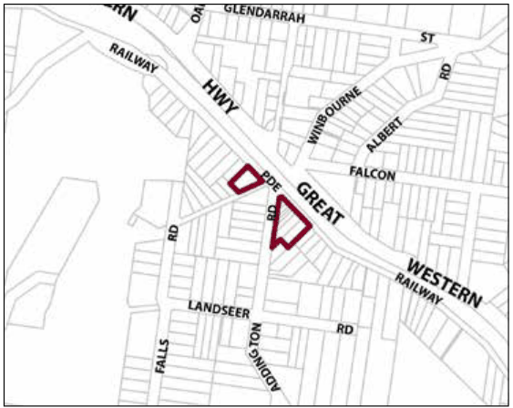
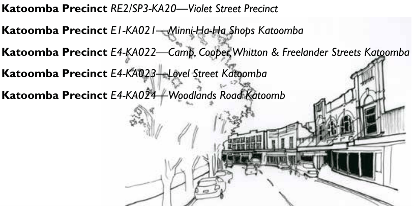

### G5.4 Hazelbrook Precinct E1-HB04 – Old Hazelbrook

### Shops Precinct

This precinct comprises a small strip of traditional shop buildings and a number of older residences used for commercial purposes set in a main street arrangement adjacent the railway station. The buildings present a diversity of periods, styles and forms, many of which have historic significance. The group retains a small-scale and local presence as a commercial precinct within a residential neighbourhood, with an emphasis on pedestrian activity and relationship to the railway station. New development should consolidate and enhance the shopping precinct as an historic local retail area with a mixture of tourist-related and local businesses. Active street frontages to shopfront buildings are to be provided to create a pedestrian-friendly and safe environment. Reference should be made to the precinct objectives in clause 7.5(4) of LEP 2015.

> [Picture on page 53: a picture, saved as a picture (images/part-g-locality-management-page-53-15.gif, 150 dpi).]

Part G5: Hazelbrook

Hazelbrook Precinct E1-HB04 – Old Hazelbrook Shops Precinct

#### Controls

C1. Development is to satisfy LEP 2015 clause 7.1 (development in villages) and be consistent with the precinct objectives of clause 7.5(4) of LEP 2015.

C2. The height of a building is not to exceed the maximum height of building set by clause 4.3 of LEP 2015  and the accompanying Height of Buildings Map.

C3. The floor space ratio of a development is not to exceed the maximum floor space ratio set by clause 4.4 of LEP 2015  and the accompanying Floor Space Ratio Map.

C4. Development is to preserve and enhance the heritage items and their settings.

C5. Development is to provide front boundary setbacks consistent with adjacent traditional shopfronts or traditional freestanding cottages as relevant, including location of forms such as verandahs, shop frontages and landscaped setbacks. The settings of existing cottages are to be respected and enhanced by new development.

C6. The maximum site coverage for buildings is 40% of the total allotment area.

C7. The minimum area to be retained as soft, pervious or landscaped area (excluding hard surfaces) is 50% of the total allotment area.

C8. Rear gardens are to be landscaped to screen parking areas and other service-related spaces.

C9. Additional floorspace should be incorporated into new rear wings or separate pavilions located to the rear of existing buildings and surrounded by landscaped open space.

Part G5: Hazelbrook

C10. New development is to have regard to the scale, forms and detailing of traditional shopfront buildings, and to ensure that where appropriate, continuous awnings and/or balconies are provided.

Note: Guidelines on traditional shopfront design are found in B3.1.3 Infill shopfront buildings in B3 Character and design, and in D9.7 Traditional shopfront buildings in Part D Heritage  where heritage considerations apply.

C11. On-site parking areas are to be accessed only from the rear of buildings, and are to be concealed from principal frontages behind retail or other business premises.

### KATOOMBA

| G6.1 | Katoomba Precinct E2-KA01—Katoomba Street and Bathurst Road Shopping Strip Precinct 678 |
|---|---|
| G6.2 | Katoomba Precinct E2-KA02—District Retail Precinct 680 |
| G6.3 | Katoomba Precinct E2-KA03 - Waratah Commercial Precinct 683 |
| G6.4 | Katoomba Precinct E2-KA04—Town Approach Precinct 685 |
| G6.5 | Katoomba Precinct E2-KA05—Town Entry Precinct 687 |
| G6.6 | Katoomba Precinct E2-KA06—Cultural Centre Precinct 689 |
| G6.7 | Katoomba Precinct R1-KA07—Lurline Street South Precinct 695 |
| G6.8 | Katoomba Precinct R1-KA08—Lurline Street North Precinct 700 |
| G6.9 | Katoomba Precinct R1-KA09—Gang Gang Street East Precinct 702 |
| G6.10 | Katoomba Precinct R3-KA10—Great Western Highway Precinct 704 |
| G6.11 | Katoomba Precinct R3-KA11—Dora Street Precinct 705 |
| G6.12 | Katoomba Precinct R1/R3-KA12—GWH Between Bowling Green Avenue and Station Street Precinct 706 |
| G6.13 | Katoomba Precinct R3-KA13—Lurline and Vale Streets Precinct 708 |
| G6.14 | Katoomba Precinct R3-KA14—Lurline Street Housing Precinct 710 |
| G6.15 | Katoomba Precinct R3-KA15—Cascade and Parke Street Edge Precinct 712 |
| G6.16 | Katoomba Precinct R3-KA16—Cnr Great Western Highway and Camp Street Precinct 714 |
| G6.17 | Katoomba Precinct R3-KA17—Katoomba Golf Course Housing Precinct 716 |
| G6.18 | Katoomba Precinct R1-KA18 - Lilianfels 719 |
| G6.19 | Katoomba Precinct R1-KA19—Echo Point Road Precinct 722 |
| G6.20 | Katoomba Precinct RE2/SP3-KA20—Violet Street Precinct 724 |
| G6.21 | Katoomba Precinct E1-KA021—Minni-Ha-Ha Shops Katoomba 727 |
| G6.22 | Katoomba Precinct E4-KA022—Camp, Cooper, Whitton & Freelander Streets Katoomba 729 |
| G6.23 | Katoomba Precinct E4-KA023—Lovel Street Katoomba 732 |
| G6.24 | Katoomba Precinct E4-KA024—Woodlands Road Katoomb 735 |

> [Picture on page 55: a picture, saved as a picture (images/part-g-locality-management-page-55-3.gif, 150 dpi).]
