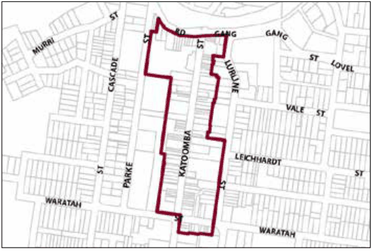

### G6.1 Katoomba Precinct E2-KA01—Katoomba Street

### and Bathurst Road Shopping Strip Precinct

The precinct is a traditional main street shopping strip in a distinct environmental setting which accommodates a diverse mix of traditional town centre uses and residential uses, serving both the local community and tourists alike. Exhibiting high levels of pedestrian amenity, convenience and safety, the precinct functions as the most active and vibrant part of the Katoomba village, with shops and other premises trading for extended hours, over evenings and on weekends. Future development will maintain a streetscape that is generally two and three storeys in scale, conserves and celebrates built heritage and historic character and is represented by a near continuous row of separate and narrow shop-fronts. New development will also generate active street frontages to all public areas including both Pioneer and Pryor Places. Reference should be made to the precinct objectives in clause 7.6(1) of LEP 2015.

> [Picture on page 56: a picture, saved as a picture (images/part-g-locality-management-page-56-15.gif, 150 dpi).]

Part G6: Katoomba

Katoomba Precinct E2-KA01—Katoomba Street and Bathurst Road Shopping Strip Precinct

#### Controls

C1. Development is to satisfy LEP 2015 clause 7.1 (Development in villages) and be consistent with the precinct objectives of clause 7.6(1) of LEP 2015.

C2. The height of a building is not to exceed the maximum height of building set by clause 4.3 of LEP 2015  and the accompanying Height of Buildings Map.

C3. The floor space ratio of a development is not to exceed the maximum floor space ratio set by clause 4.4 of LEP 2015  and the accompanying Floor Space Ratio Map.

Note: Refer to LEP 2015 clause 4.3A (Exceptions to the maximum floor space ratio and height of buildings) for additional provisions regarding height and floor space for development in this precinct.

C4. Buildings are generally to have zero front and side setbacks; however, when there is a front building line established by adjacent buildings, new development may provide a setback consistent with the adjacent setback; and where the side boundary adjoins the public domain, setbacks greater than zero may be considered, but only where it can be demonstrated that an active street frontage will be provided.

C5. Visible retail or commercial activity is to be provided along the entire length of primary street frontages to Katoomba Street, Bathurst Road and Waratah Street.

C6. New development with secondary frontages to a public road, laneway or public place is to provide a visible and active street frontage distributed along a minimum of 65% of that frontage.

C7. Development fronting Katoomba Street, Waratah Street and Bathurst Road is to generally provide the following:

(a) narrow terraced building forms of masonry construction, and

Part G6: Katoomba

(b) parapets that step with the topography, with pitched or skillion roofs behind, and

(c) symmetry and vertical proportion of window and door openings, and

(d) articulation of shopfront elements, and

(e) cantilevered metal awnings.

Note: Guidelines on traditional shopfront design are found in B3.1.3 Infill shopfront buildings in B3 Character and design, and in D9.7 Traditional shopfront buildings in Part D Heritage  where heritage considerations apply.

C8. Signage is to be sympathetic to the style and detailing of the shop front, and be of appropriate size, scale and location.

C9. Buildings fronting Lurline Street are to present a frontage compatible with the diversity of the predominantly residential streetscape.

C10. Continuous overhead awnings, where appropriate, are to be provided along the length of a frontage to a street, laneway or public place.

C11. Appropriate levels of lighting are to be incorporated into all on-site pedestrian areas. All light fittings are to be of a form and character consistent with that of the building.

C12. On-site car parking is not to be accessed from Katoomba Street or Waratah Street.
