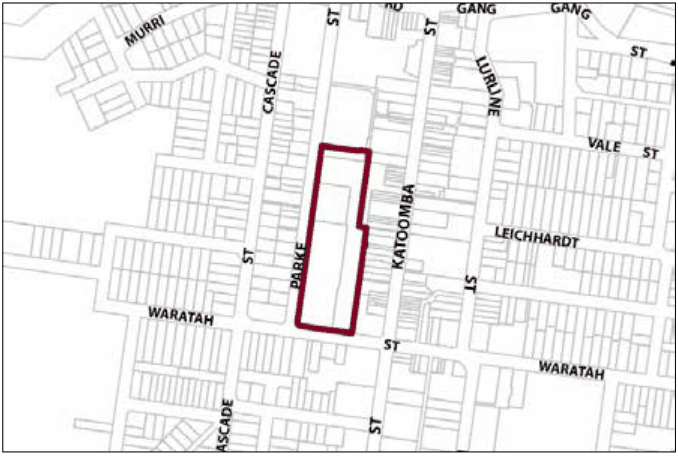

### G6.2 Katoomba Precinct E2-KA02—District Retail

### Precinct

Serving as the core area for district-scale retailing facilities, this precinct will see increases in commercial floor space in response to increasing retailing demands for upper mountains residents. Future development is to be represented in well-designed, multi-level buildings of a more contemporary form. Building designs will incorporate stronger interfaces with Parke and Waratah Streets, represented by active street frontages and prominent building entries. The precinct provides an enhanced public domain that offers high levels of accessibility to both pedestrians and vehicles, but minimises conflicts between the two. The precinct will be well served by vehicle parking and heavy vehicle access, however neither will be visually prominent elements. The precinct will also provide clear and tangible links between existing retailing on Katoomba Street, and Katoomba Precinct E2-KA06 to the north. Reference should be made to the precinct objectives in clause 7.6(2) of LEP 2015.

> [Picture on page 58: a picture, saved as a picture (images/part-g-locality-management-page-58-17.gif, 150 dpi).]

Part G6: Katoomba

Katoomba Precinct E2-KA02—District Retail Precinct

#### Controls

C1. Development is to satisfy LEP 2015 clause 7.1 (Development in villages) and be consistent with the precinct objectives of clause 7.6(2) of LEP 2015.

C2. The height of a building is not to exceed the maximum height of building set by clause 4.3 of LEP 2015  and the accompanying Height of Buildings Map.

C3. The floor space ratio of a development is not to exceed the maximum floor space ratio set by clause 4.4 of LEP 2015  and the accompanying Floor Space Ratio Map.

C4. All viewing opportunities from the podium level of the Blue Mountains Cultural Centre to the town, Jamison Valley and Frank Walford Park are to be maintained. A view analysis may be required.

Note: Podium level is defined as: at or below an Australian Height Datum of 1024.5m, at or below the finished level of College Lane at the northern boundary of the precinct, and at or below 12m above the finished level of College Lane at the south eastern boundary of the precinct.

C5. Buildings with a frontage to Parke and Waratah Streets are generally to have a zero setback to that frontage, except where it can be demonstrated that the increased setback forms part of a building entry and incorporates an active street frontage.

C6. Visible retail or other commercial activity is to be provided along a minimum of 50% of a frontage to a public road or pathway, except in the case of Pioneer Place, where a minimum of 65% is to be provided.

C7. Where development involves long elevations, they are to present varied heights and forms.

Part G6: Katoomba

C8. Walls in new development visible from the public domain are not to be left blank, unadorned or unarticulated.

C9. Roof forms to new development are to conceal mechanical plant and equipment from adjacent buildings, private open space and public areas.

C10. Awnings or colonnades are to be provided over the entire length of public footpaths and pedestrian areas.

C11. Paths and plaza areas are to minimise conflicts between vehicles and pedestrians.

C12. Clear sight lines are to be provided along the entire length of a pedestrian area.

C13. New development is to incorporate appropriate levels of lighting to all pedestrian areas. All light fittings are to have a form and character that is consistent with that of the building.

C14. The design and provision of any pedestrian accessways to Waratah Street, Parke Street, or adjoining precincts is to ensure equitable access for all pedestrians.

C15. No additional vehicular access points are permitted off Parke or Waratah Streets.

C16. Primary access to parking is to be off Parke Street.

C17. Any parking and heavy vehicle loading and manoeuvring areas are to be designed to minimise visual impact when viewed from the public domain, and to be safely and efficiently designed.

Part G6: Katoomba
