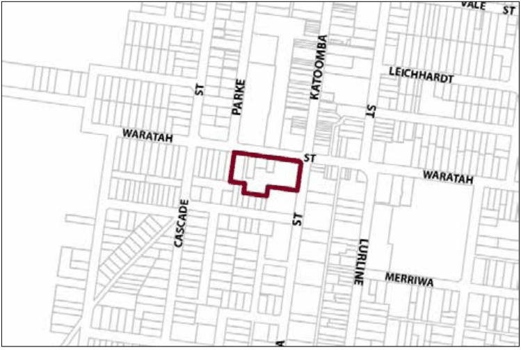

### G6.3 Katoomba Precinct  E2-KA03 -  Waratah

### Commercial Precinct

Defining the southern edge of the town centre, this precinct serves as a transition between the retail core and adjacent residential areas. It accommodates a mix of land uses including lower order retail activities, but is characterised by a predominance of commercial and community activities. The form and scale of new development is to respond to the topography of the site, to reflect the mix of residential and commercial uses and to be limited to one and two-storey buildings. Access and parking is to be managed efficiently to minimise conflicts with vehicle movements in Waratah Street and the precinct to the north. Reference should be made to the precinct objectives in clause 7.6(3) of LEP 2015.

> [Picture on page 61: a picture, saved as a picture (images/part-g-locality-management-page-61-13.gif, 150 dpi).]

Part G6: Katoomba

Katoomba Precinct  E2-KA03 -  Waratah Commercial Precinct

#### Controls

C1. Development is to satisfy LEP 2015 clause 7.1 (Development in villages) and be consistent with the precinct objectives of clause 7.6(3) of LEP 2015.

C2. The height of a building is not to exceed the maximum height of building set by clause 4.3 of LEP 2015  and the accompanying Height of Buildings Map.

C3. The floor space ratio of a development is not to exceed the maximum floor space ratio set by clause 4.4 of LEP 2015  and the accompanying Floor Space Ratio Map.

Note: Refer to LEP 2015 clause 4.3A (Exceptions to the maximum floor space ratio and height of buildings) for additional provisions regarding height and floor space for development in this precinct.

C4. New development with a frontage to Waratah or Katoomba Street is generally to have a zero setback; however greater setbacks may be considered where it can be demonstrated that the setback incorporates active street frontages.

C5. Development is to respond to the topography of the site and step down the slope.

C6. Walls visible from the public domain shall not be left blank, unadorned or unarticulated.

C7. Development shall present visible retail or other commercial activity along a minimum of 65% of a frontage to Waratah and Katoomba Streets.

C8. Development fronting the public domain shall provide continuous overhead awnings along the length of that frontage.

Part G6: Katoomba

C9. Any parking and heavy vehicle loading and manoeuvring areas are to be designed to minimise visual impact when viewed from the public domain, and to be safely and efficiently designed.
