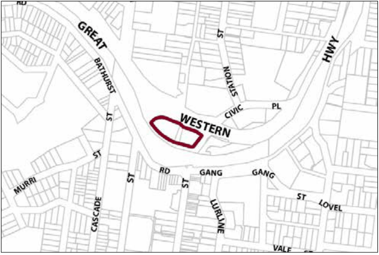

### G6.4 Katoomba Precinct E2-KA04—Town Approach

### Precinct

Located adjacent to the primary road and rail corridors, this precinct will experience substantial redevelopment of sites and will operate as both a “gateway” and transport interchange for the Katoomba Village. New development will support this gateway role by presenting urban design of the highest quality that contributes to a positive first experience of Katoomba. This, together with a mix of land uses that support the role of the town centre, will entice passing traffic to enter the town. Trading over extended hours, development will provide passive surveillance and improved public safety and amenity. The precinct’s interchange role will be supported by ample provision of commuter car parking, coach parking and convenient pedestrian access to the town centre. Whilst offering high levels of accessibility to both pedestrian and vehicles, potential conflicts between the two will be minimised. Reference should be made to the precinct objectives in clause 7.6(4) of LEP 2015.

> [Picture on page 63: a picture, saved as a picture (images/part-g-locality-management-page-63-17.gif, 150 dpi).]

Part G6: Katoomba

.

Katoomba Precinct E2-KA04—Town Approach Precinct

#### Controls

C1. Development is to satisfy LEP 2015 clause 7.1 (Development in villages) and be consistent with the precinct objectives of clause 7.6(4) of LEP 2015.

C2. The height of a building is not to exceed the maximum height of building set by clause 4.3 of LEP 2015  and the accompanying Height of Buildings Map.

C3. The floor space ratio of a development is not to exceed the maximum floor space ratio set by clause 4.4 of LEP 2015  and the accompanying Floor Space Ratio Map.

Note: Refer to LEP 2015 clause 4.3A (Exceptions to the maximum floor space ratio and height of buildings) for additional provisions regarding height and floor space for development in this precinct.

C4. Buildings fronting Goldsmith Place are to have zero setback to that frontage; however, greater setbacks may be considered, but only where it can be demonstrated that the setback incorporates active street frontages.

C5. New development is to have visible and interactive uses distributed regularly along 65% of its frontage to Goldsmith Place.

C6. Where development involves long elevations, they are to present varied heights and forms.

C7. Walls in new development visible from the public domain are not to be left blank, unadorned or unarticulated.

Part G6: Katoomba

C8. Roof forms to new development are to conceal mechanical plant and equipment from adjacent development, private open space and the public domain.

C9. New development is to provide gateway or entry elements at the corner and frontage of the Great Western Highway and Yeaman Bridge.

C10. All parking areas and delivery docks are to be concealed from public view.

C11. New development is to provide awnings or colonnades over the entire length of public footpaths and pedestrian areas.

C12. New development is to provide pathways that minimise conflicts between vehicles and pedestrians.

C13. Clear sight lines are to be provided along the entire length of a pedestrian area.

C14. New development is to incorporate appropriate levels of lighting to all pedestrian areas. All light fittings are to have a form and character that is consistent with that of the building.

C15. New development is to provide public pedestrian access between Yeaman Bridge and Goldsmith Place, where development provides a frontage to both places.
