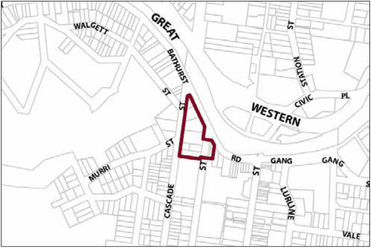

### G6.5 Katoomba Precinct E2-KA05—Town Entry Precinct

This precinct derives its prominence from its town entry position and associated visibility from Yeaman Bridge, Bathurst Road and Parke Street. New development provides high quality entry statements and contributes to the definition of Katoomba as a town with a unique character defined by its historic built form and environmental setting. This precinct will support the viability of the town’s core retail areas by providing a mix of land uses including commercial, residential and retailing opportunities. Future development will provide a streetscape that is generally two storeys in scale, conserves and celebrates built heritage and period items, and is represented by a near continuous row of separate shop buildings on narrow-fronted allotments. Traffic management measures are provided to facilitate ready vehicular access to the town centre. Reference should be made to the precinct objectives in clause 7.6(5) of LEP 2015.

> [Picture on page 65: a picture, saved as a picture (images/part-g-locality-management-page-65-15.gif, 150 dpi).]

Part G6: Katoomba

Katoomba Precinct E2-KA05—Town Entry Precinct

#### Controls

C1. Development is to satisfy LEP 2015 clause 7.1 (Development in villages) and be consistent with the precinct objectives of clause 7.6(5) of LEP 2015.

C2. The height of a building is not to exceed the maximum height of building set by clause 4.3 of LEP 2015  and the accompanying Height of Buildings Map.

C3. The floor space ratio of a development is not to exceed the maximum floor space ratio set by clause 4.4 of LEP 2015  and the accompanying Floor Space Ratio Map.

Note: Refer to LEP 2015 clause 4.3A (Exceptions to the maximum floor space ratio and height of buildings) for additional provisions regarding height and floor space for development in this precinct.

C4. Buildings are to have zero setback to the primary street frontage.

C5. Buildings are to extend across the full width of the primary street frontage.

C6. New development is to provide visible retail or other commercial activity along the entire length of primary street frontages.

C7. New development is to provide a visible and active street frontage distributed along a minimum of 65% of secondary frontages to a public road, laneway or public place.

C8. Development fronting Parke Street and Bathurst Road is to generally provide the following:

(a) narrow terraced building forms of masonry construction, and

Part G6: Katoomba

(b) parapets that step with the topography, with pitched or skillion roofs behind, and

(c) symmetry and vertical proportion of window and door openings, and

(d) articulation of shopfront elements, and

(e) cantilevered metal awnings.

Note: Guidelines on traditional shopfront design are found in B3.1.3 Infill shopfront buildings in B3 Character and design, and in D9.7 Traditional shopfront buildings in Part D Heritage  where heritage considerations apply.

C9. Signage is to be sympathetic to the style and detailing of the shop front, and be of appropriate size, scale and location.

C10. New development is to provide continuous overhead awnings along the length of a frontage to a street, laneway or public place.

C11. New development is to incorporate appropriate levels of lighting to all pedestrian areas. All light fittings are to have a form and character that is consistent with that of the building.

C12. On-site car parking is not to be accessed directly from Bathurst Road.
