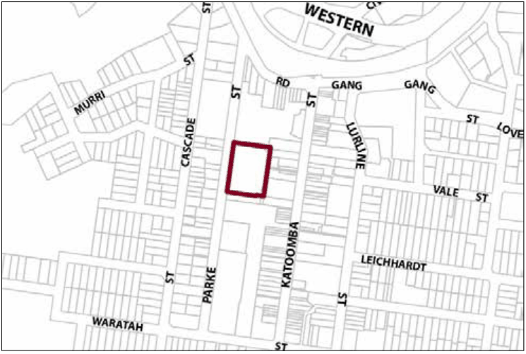

### G6.6 Katoomba Precinct E2-KA06—Cultural Centre

### Precinct

The precinct is defined by the success of the urban renewal strategy that has seen it transformed from a predominantly vacant site into a place that provides a focus for cultural and social activities and learning. The precinct includes shopping experiences, contributing to Katoomba’s revitalisation. The development enhances the urban environment in this part of Katoomba and defines the western edge of the town centre as a principal vehicular entry into the town, which is also a gateway to the Echo Point precinct. The highly successful new landmark buildings contribute a contemporary layer to Katoomba’s townscape qualities and to the surrounding urban pattern. The podium provides views of the town’s historic streetscapes and the magnificent natural setting. The development is immediately recognisable to visitors of Katoomba as an identifiable cultural and tourism destination. The community and visitors value this place as it celebrates the unique character of Katoomba, while telling its own ongoing story. Reference should be made to the precinct objectives in clause 7.6(6) of LEP 2015.

> [Picture on page 67: a picture, saved as a picture (images/part-g-locality-management-page-67-18.gif, 150 dpi).]

Part G6: Katoomba

Katoomba Precinct E2-KA06—Cultural Centre Precinct

#### Controls

C1. Development is to satisfy LEP 2015 clause 7.1 (Development in villages) and be consistent with the precinct objectives of clause 7.6(6) of LEP 2015.

C2. The height of a building is not to exceed the maximum height of building set by clause 4.3 of LEP 2015  and the accompanying Height of Buildings Map.

C3. The floor space ratio of a development is not to exceed the maximum floor space ratio set by clause 4.4 of LEP 2015  and the accompanying Floor Space Ratio Map.

C4. The maximum site cover for buildings with enclosed walls that are to be erected on the podium level is not to exceed 75% of the total podium area.

Design considerations

C5. Development of the cultural centre is to be the product of an integrated design approach.

C6. Development is to create significant, interlinked public spaces that can be used independently or in conjunction with the cultural centre.

C7. Retail development is to include a district supermarket or a major store and may include associated specialty outlets.

C8. A direct, dedicated and vertically integrated pedestrian route is to link all levels of the cultural facility, retail area and car park.

Part G6: Katoomba

C9. Facades are to generally be highly articulated and differentiated to incorporate appropriate rhythm, with proportions and depth in the facade to reduce bulk and mass.

C10. Long, continuous elevations are to be avoided, with principal facades broken into discrete bays or modules; verticality is encouraged.

C11. Windows, openings and cultural displays are to be a predominant element on the eastern facade to College Lane.

C12. Windows are to be provided in the southern facade of the library building.

C13. The design of parking and heavy vehicle loading and manoeuvring areas on the Parke Street facade is to minimise visual impact when viewed from public streets and places.

C14. Parke Street elevations are to provide a variety of architectural and urban design elements such as landscaping, viewing places, and windows or openings, with art works or display cases provided along the windowless facades.

C15. The north-western entry of the site is to achieve a sense of visual connectivity between Parke Street and the public court by measures such as the provision of an open visual entry statement and vistas of the public court for passing vehicles and pedestrians.

C16. Doors, which are to be provided to any loading bay, are to be fully integrated with architectural elements of the street facade.

C17. Building design elements such as the use of finishes, materials and colours are to be sympathetic to the historic town centre and adjacent heritage items and avoid large expanses of reflective materials.

C18. The building design is to indicate locations for public art and commercial signs which will be presented in a manner that does not compromise the building’s contribution to the streetscape.

C19. The development and adjacent public places are to adopt an integrated approach to urban design, landscaping, the display of public art and built form, which serves to identify, and act as a visual attractor for, the cultural facility.

Energy conservation

C20. The design and siting of buildings is to maximise energy conservation techniques in construction, and is to use materials with low embodied energy.

Part G6: Katoomba

C21. Water conservation and water management systems are to be implemented.

Public spaces

C22. A major court is to be proved in the northern part of the Precinct at the podium level, providing:

(a) a link to the Carrington Hotel to the north, and

(b) access between College Lane and Parke Street, which is suitable for use by all members of the community including those with limited mobility.

C23. The court is to include some shelter and soft landscaping elements to assist with the creation of pleasant liveable space.

C24. Development is to provide public spaces that are integrated by a suite of directional signage, street furniture and light fittings, which complement and reinforce links to prominent adjoining public places.

C25. A development application is to show how crime minimisation is to be achieved, particularly for public spaces that could lead to anti-social behaviour.

C26. The public spaces are to be capable of housing public art initiatives and other events.

C27. Development is to include public spaces and buildings which provide places from which to view the town and the Jamison Valley and Frank Walford Park.

Traffic management

C28. A Traffic Impact Assessment shall be prepared which identifies the traffic impacts of proposed development and provides mitigation measures, if required, for the local road network.

C29. College Lane is to be designed for shared pedestrian and vehicular access.

Heritage

C30. Architectural design of any building must respect the heritage significance of the site and its heritage setting.

Part G6: Katoomba

C31. Roof forms are to be designed to be viewed from above, with mechanical plant and equipment being concealed or treated to minimise any visual impact.

C32. Any heritage impact statement required for new development is to demonstrate that the proposed development does not significantly impede views from the upper terrace level of the Carrington Hotel to the Jamison Valley.

C33. The heritage significance of the Precinct as the location of the first permanent private residence in Katoomba (Froma House, c1867) and as a school site since 1912 shall be interpreted as part of any development proposed for the site.

Advertising signage

C34. The design and size of advertising signage is to:

(a) be compatible with the cultural facility;

(b) respect the cultural significance of the building;

(c) reduce visual clutter by rationalising and simplifying signage; and

(d) be the product of an integrated signage package for the entire building or the precinct as a whole.

C35. Advertising signage is to be fully integrated with the architectural elements of that part of the building on which it is located.

C36. Advertising signage that identifies, or relates to the use of, the entire building or the precinct as a whole shall:

(a) be designed to complement the display of any public art work on the building on which it is located, and

(b) be located below the podium level.

Note: Podium level is defined as: at or below an Australian Height Datum of 1024.5m, at or below the finished level of College Lane at the northern boundary of the precinct, and at or below 12m above the finished level of College Lane at the south eastern boundary of the precinct.

C37. Advertising signage related exclusively to development for the purpose of the district supermarket or other commercial premises located below the podium level, and any associated facilities, is to:

(a) be compatible with the scale and proportion of the building on which the signage is to be located, and

Part G6: Katoomba

(b) be limited to business identification purposes for the major tenant for any signage within the precinct visible from Parke Street, and shall be contained within an envelope or envelopes with a total maximum area of 15m2, and

(c) be limited to business identification purposes for the major tenant and associated retail tenants for any signage within the precinct that is visible from College Lane, and shall be contained within an envelope or envelopes with a total maximum area of 20m2, and

(d) not be used for product promotion or other temporary advertising purposes.

Note: Podium level is defined as: at or below an Australian Height Datum of 1024.5m, at or below the finished level of College Lane at the northern boundary of the precinct, and at or below 12m above the finished level of College Lane at the south eastern boundary of the precinct.

C38. Advertising signage must be attached to a building and shall:

(a) be flush to the wall and not protrude beyond 300mm from the wall to which the structure is attached, or

(b) be suspended under an awning, entrance or the like, but only where a clearance of 2500mm is provided between the structure and the floor or road pavement below.

C39. Advertising signage may be considered that does not comply with Control 38 above only if:

(a) it is demonstrated that the signage assists in reducing the area of advertising signage and is of a high design quality and finish, or

(b) the signage relates to development for the purpose of a cultural facility.

C40. Any illumination of advertising signage must not:

(a) result in unacceptable glare, or

(b) affect the safety of pedestrians or vehicles, or

(c) detract from the amenity of any residence within the locality.

C41. To ensure that advertising signage does not compromise safety, signage shall be designed so that:

(a) users of the public road are not hindered or distracted by signage, and

Part G6: Katoomba

(b) the sightlines for pedestrians and/or cyclists from public places are not obstructed.
