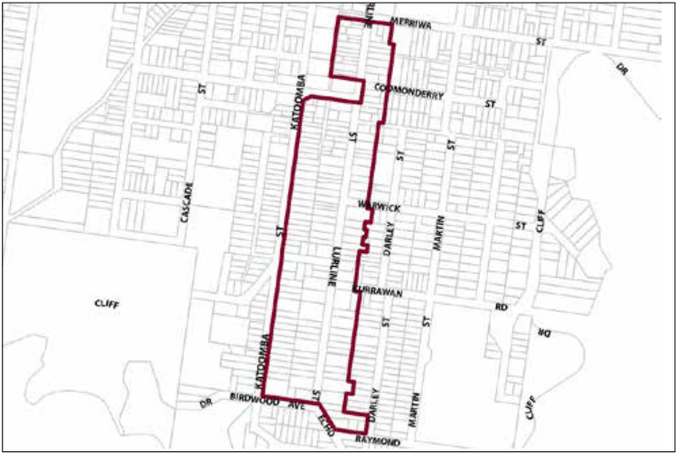

### G6.7 Katoomba Precinct R1-KA07—Lurline Street South

### Precinct

This location presents a range of tourist-related uses that contribute to the visitor experience by providing an interesting and interactive streetscape. Development retains a generally single-storey scale and reflects traditional architectural features of the historic built form within this precinct. Some typical 19th/early 20th century details present in the locality and are:-

• fence and balustrade railings of vertical or diagonal forms (not horizontal), and

• timber verandahs roofed independently from the main roof, and

• timber windows, usually double hung or casement, and

• doors of panelled construction, and

• weatherboarding and timberwork dressed and painted, and

• circular downpipes, and

• chimneys and chimney pots, and

• fret-worked timber barge boards, and

Part G6: Katoomba

• timber supported window canopies.

It is essential for new development in this area to be compatible with the predominant heritage and domestic character of the precinct, particularly that typified by the numerous, high-quality Federation period houses present. Reference should be made to the precinct objectives in clause 7.6(7) of LEP 2015.

> [Picture on page 74: a picture, saved as a picture (images/part-g-locality-management-page-74-1.gif, 150 dpi).]

Katoomba Precinct R1-KA07—Lurline Street South Precinct

#### Controls

Part G6: Katoomba

C1. Development is to satisfy LEP 2015 clause 7.1 (Development in villages) and be consistent with the precinct objectives of clause 7.6(7) of LEP 2015.

C2. The height of a building is not to exceed the maximum height of building set by clause 4.3 of LEP 2015  and the accompanying Height of Buildings Map.

C3. The floor space ratio of a development is not to exceed the maximum floor space ratio set by clause 4.4 of LEP 2015  and the accompanying Floor Space Ratio Map.

C4. Development is to have a minimum 10m setback to front road boundaries. This area is to be fully landscaped utilising non-invasive exotic plantings prevalent in the locality. Detailed landscaping plans may be required for larger applications.

C5. The minimum setback for a front wall of a building or carport, for a non-residential land use, is 3m.

C6. The maximum area of any site which is to be developed with buildings is 30%.

C7. No more than 10% of the site is to be hard paved.

C8. New structures are not to dominate or compete with those existing.

C9. Streetscape qualities are to be preserved.

C10. New development is to provide activated street frontages.

Forms and finishes

C11. The building mass of new developments is to be broken into elements of no more than 10m in any dimension to ensure an appropriate scale results.

C12. Roof form is to relate to neighbouring examples, and have a traditional pitch (approximately 35 degrees) in hipped and/or gabled forms. Flat or simple skillion roofs for a main roof form are inappropriate unless concealed by a parapet.

C13. Roof cladding is to be generally corrugated metal sheeting or unglazed terracotta (Marseille) tiles.

Part G6: Katoomba

C14. Buildings are to incorporate forms and materials that are consistent with, or complementary to, the periods and architectural character of adjoining buildings. This is to include gables, verandahs, hipped roofs, timber cladding or other architectural elements. The treatment of facade elements such as windows, walling and verandahs are to be in keeping with the predominant proportions of existing buildings.

C15. New work is to be sympathetic to older details without direct imitation. New development is to be remain subordinate to the established character through simplified detailing.

C16. New development is not to conflict in character or scale, but maintain consistency of streetscape.

C17. Walls in new development visible from the public domain are not to be left blank, unadorned or unarticulated.

C18. Timber column-supported verandahs should be incorporated in the front elevation where possible and appropriate, to produce a shadow-effect and be a defining element of a building facade. Verandah widths can be varied to suit the measure of climatic control required. Verandahs need not return around all sides of a building to provide a desirable appearance.

C19. The verticality of windows is to be preserved where visible. Both doors and windows can be grouped together in bays to provide large glass areas if required and where appropriate.

C20. Timber windows are generally to be used in preference to aluminium particularly where visible. Timber windows are generally to be painted externally.

C21. Front fences are to match the primary material of the house, and be either of low brick construction with piers and panels, timber pickets or hedges.

C22. Appropriate wall surfaces are to be used. These include simple face brickwork, plain dry-pressed ‘commons’ bricks, rendered and painted brick walls, timber weatherboards, and fibre cement sheeting.

C23. Traditional heritage colour schemes are generally to be followed; a light stone colour should be chosen for walling, with a dark colour for architectural trim. Corrugated metal roofs are preferably dark green, dark red or plain galvanised steel. Many standard ‘Colorbond’ colours are not appropriate for historic precincts.

C24. Buildings are to be constructed on solid brick or stone bases surrounding sub-floor areas.

C25. Commercial signage is to be co-ordinated to reflect a village character, with local design themes predominating over corporate signage.

Part G6: Katoomba

Landscaping

C26. Existing plantings, mature trees and dominant garden elements are to be generally maintained. This is of particular importance in front setback areas. Landscaping of new developments is to repeat appropriate elements of existing plantings in the locality. A strong preference is to be given to non-invasive exotic species.

On-site parking

C27. Garages, access and car parking are to be screened from the public domain and located behind the front building line so as not to adversely impact upon streetscape, pedestrian circulation, and building character.

C28. All parking demands generated by developments are to be met fully on-site.

Existing Buildings (Dwellings)

C29. Where non-residential uses on developed sites are proposed, priority is to be given to the conservation, adaptive re-use and restoration of existing dwellings. The demolition of existing buildings will generally not be supported unless, in the opinion of the Council, the subject building is not contributory to the character and value of the streetscape.

Existing Motels

C30. The existing motels in this precinct are discordant elements and their sympathetic redevelopment is encouraged, to provide a more domestic scale. This generally means:

(a) articulated forms of no greater than 10m by 15m, and

(b) one or two-storey height, and

(c) traditional building and roof forms, and

(d) parking underground or out of sight of the road, and

(e) driveway entrances with a domestic scale of approximately 3m wide, and

Part G6: Katoomba

(f) substantial tree planting, and

(g) limited signage, and

(h) vehicular access limited to Katoomba Street and Lurline Street.
