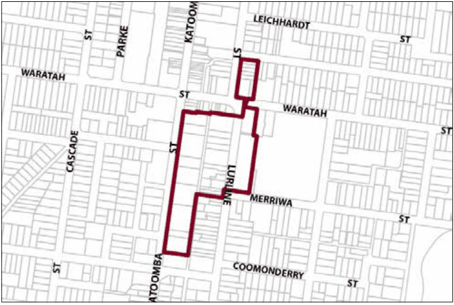

### G6.8 Katoomba Precinct R1-KA08—Lurline Street

### North Precinct

The precinct is characterised by a diversity of residential and commercial uses catering to both local  residents and tourists. It contains a mixture of single dwellings, larger character properties such as guesthouses and hotels, as well as modern buildings which interrupt the historic character of the town centre fringes. Built form is of a comparatively denser scale and takes advantage of the unique views available to the east over the Jamison Valley. Architectural detailing reflects forms and finishes present in the historic guesthouses and other residential buildings typical in and around Lurline Street. Future development is to consolidate the higher density built form and tourist land uses within this area. The consolidation of land uses assists in providing a connection between the Katoomba town centre and Echo Point. Reference should be made to the precinct objectives in clause 7.6(8) of LEP 2015.

> [Picture on page 78: a picture, saved as a picture (images/part-g-locality-management-page-78-15.gif, 150 dpi).]

Part G6: Katoomba

Katoomba Precinct R1-KA08—Lurline Street North Precinct

#### Controls

C1. Development is to satisfy LEP 2015 clause 7.1 (Development in villages) and be consistent with the precinct objectives of clause 7.6(8) of LEP 2015.

C2. The height of a building is not to exceed the maximum height of building set by clause 4.3 of LEP 2015  and the accompanying Height of Buildings Map.

C3. The floor space ratio of a development is not to exceed the maximum floor space ratio set by clause 4.4 of LEP 2015  and the accompanying Floor Space Ratio Map.

C4. Front setbacks are to be consistent with setbacks of adjoining properties.

C5. The maximum site coverage of any building is not to exceed 50% of the total site area.

C6. New development must enable view sharing with surrounding development, particularly from main habitable rooms of that development.

C7. New development must be able to provide for basement car parking if required.

C8. New development is to incorporate through-site pedestrian links to improve the permeability of the area if appropriate and desirable.

C9. New development is to provide activated street frontages.

Part G6: Katoomba

C10. New development is to be sympathetic to the traditional building forms, materials and details of the precinct, including the use of traditionally-pitched roofs, articulated layouts and forms, verandahs, timber joinery, vertically–proportioned openings and some painted external finishes, with a curtilage of landscaped areas and an address to the street provided. New development is to be similar in form and materials to quality older buildings but subservient in detail to distinguish it as new work.

C11. Walls in new development visible from the public domain are not to be left blank, unadorned or unarticulated.

C12. Commercial signage is to be co-ordinated to reflect a village character, where local design themes predominate over corporate signage.

C13. Garages, access and car parking are to be screened from the public domain and located behind the front building line so as not to adversely impact upon streetscape, pedestrian circulation, and building character.
