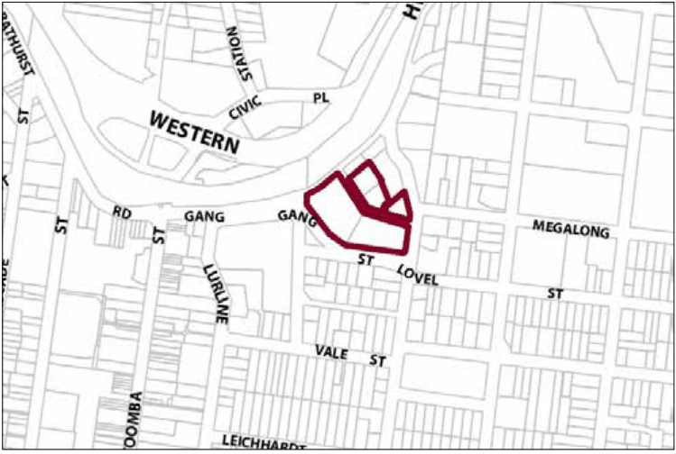

### G6.9 Katoomba Precinct R1-KA09—Gang Gang Street

### East Precinct

Situated on one of the highest points in Katoomba and with expansive views to the Jamison Valley, development on this site reinforces the historically significant tradition of guesthouse accommodation within the precinct. Development is responsive to the historic significance of buildings within the precinct and provides for a transition of building scale, with reduced scale toward the land within the zone E4 Environmental Living to the north. The commanding presence of the built form within a landscape setting is maintained and there are strong pedestrian linkages between the precinct and the town centre. Period features are retained. Any additions to the existing buildings are consistent with the historic architectural themes. Reference should be made to the precinct objectives in clause 7.6(9) of LEP 2015.

> [Picture on page 80: a picture, saved as a picture (images/part-g-locality-management-page-80-14.gif, 150 dpi).]

Part G6: Katoomba

Katoomba Precinct R1-KA09—Gang Gang Street East Precinct

#### Controls

C1. Development is to satisfy LEP 2015 clause 7.1 (Development in villages) and be consistent with the precinct objectives of clause 7.6(9) of LEP 2015.

C2. The height of a building is not to exceed the maximum height of building set by clause 4.3 of LEP 2015  and the accompanying Height of Buildings Map.

C3. The floor space ratio of a development is not to exceed the maximum floor space ratio set by clause 4.4 of LEP 2015  and the accompanying Floor Space Ratio Map.

C4. The minimum setback from the Gang Gang Street boundary of the precinct is to be consistent with that established by existing development.

C5. The minimum setback from the southern frontage of Penault Avenue is 2m.

C6. The minimum setback from the northern frontage of Penault Avenue is 8m.

C7. The minimum setback from the precinct boundary adjoining Glenview Street is 3m.

C8. The maximum site coverage for buildings shall not exceed 50% of the total site area.

C9. Development is to retain and enhance the landscape setting of buildings fronting Gang Gang Street, with terraced gardens and paths extending down to street level.

C10. New development is to incorporate forms and finishes that are consistent with, or complement the periods and architectural character of adjoining buildings.

Part G6: Katoomba

C11. Walls that are visible from any public road or the transport corridor are not to be left blank, unadorned or unarticulated.

C12. Commercial signage is to be non-obtrusive and complement the historical character of the precinct.

C13. Parking is to be located off Penault Avenue.

C14. Existing landscaping within the building setback to the north of Penault Avenue is to be retained or enhanced as part of any development proposal.
