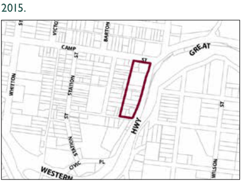

### G6.10	 Katoomba Precinct R3-KA10—Great Western

### Highway Precinct

This location provides opportunities for the provision of urban housing in a form that positively contributes to the eastern approach to Katoomba and incorporates distinctive tree planting. Reference should be made to the precinct objectives in clause 7.6(10) of LEP 2015.

> [Picture on page 82: a picture, saved as a picture (images/part-g-locality-management-page-82-8.gif, 150 dpi).]

Katoomba Precinct R3-KA10—Great Western Highway Precinct

#### Controls

Part G6: Katoomba

C1. Development is to satisfy LEP 2015 clause 7.1 (Development in villages) and be consistent with the precinct objectives of clause 7.6(10) of LEP 2015 .

C2. The height of a building is not to exceed the maximum height of building set by clause 4.3 of LEP 2015  and the accompanying Height of Buildings Map.

C3. The floor space ratio of a development is not to exceed the maximum floor space ratio set by clause 4.4 of LEP 2015  and the accompanying Floor Space Ratio Map.

C4. The minimum setback from the Great Western Highway is 10m.

C5. The existing dwelling houses (excluding sheds and buildings ancillary to the dwelling house) are to be retained and restored as part of the redevelopment of any site.

C6. Tree plantings in accordance with the Street Tree Masterplan are to be provided within the front building setback of allotments that front the Great Western Highway to enhance the eastern entry to Katoomba.

C7. Development is to provide an activated and pedestrian-friendly street front to Edwin Lane and Bowling Green Avenue.
