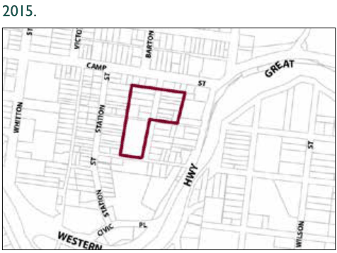

### G6.11	 Katoomba Precinct R3-KA11—Dora Street

### Precinct

Alternative forms of housing are provided in close proximity to community uses and Katoomba town centre whilst retaining the values within the heritage conservation area. Reference should be made to the precinct objectives in clause 7.6(11) of LEP 2015.

> [Picture on page 83: a picture, saved as a picture (images/part-g-locality-management-page-83-8.gif, 150 dpi).]

Katoomba Precinct R3-KA11—Dora Street Precinct

#### Controls

Part G6: Katoomba

C1. Development is to satisfy LEP 2015 clause 7.1 (Development in villages) and be consistent with the precinct objectives of clause 7.6(11) of LEP 2015.

C2. The height of a building is not to exceed the maximum height of building set by clause 4.3 of LEP 2015  and the accompanying Height of Buildings Map.

C3. The floor space ratio of a development is not to exceed the maximum floor space ratio set by clause 4.4 of LEP 2015  and the accompanying Floor Space Ratio Map.

C4. The minimum setback from the boundary to Dora Street and Edwin Lane is 4m.

C5. The existing dwelling houses (excluding sheds and buildings ancillary to the dwelling house) are to be retained and restored as part of the redevelopment of the site.

C6. Development is to provide an activated and pedestrian-friendly street front to Edwin Lane and Dora Street. The activated street front may be achieved through incorporation of the existing dwellings as part of the development, which is encouraged.
